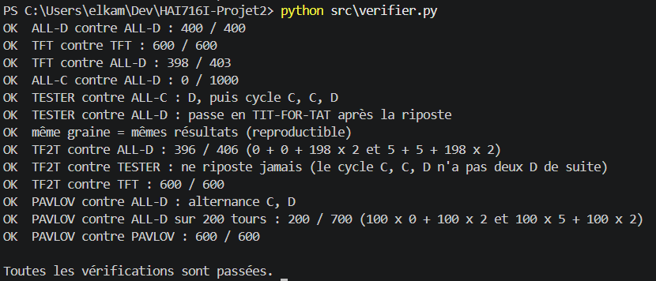
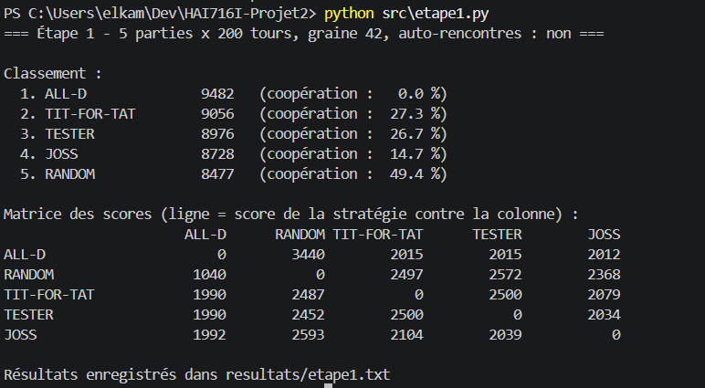
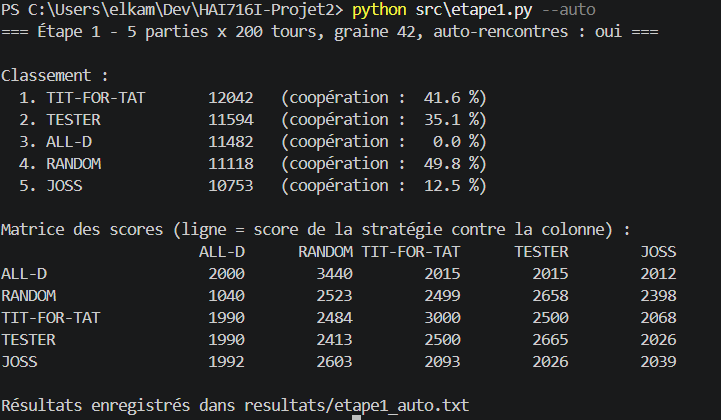
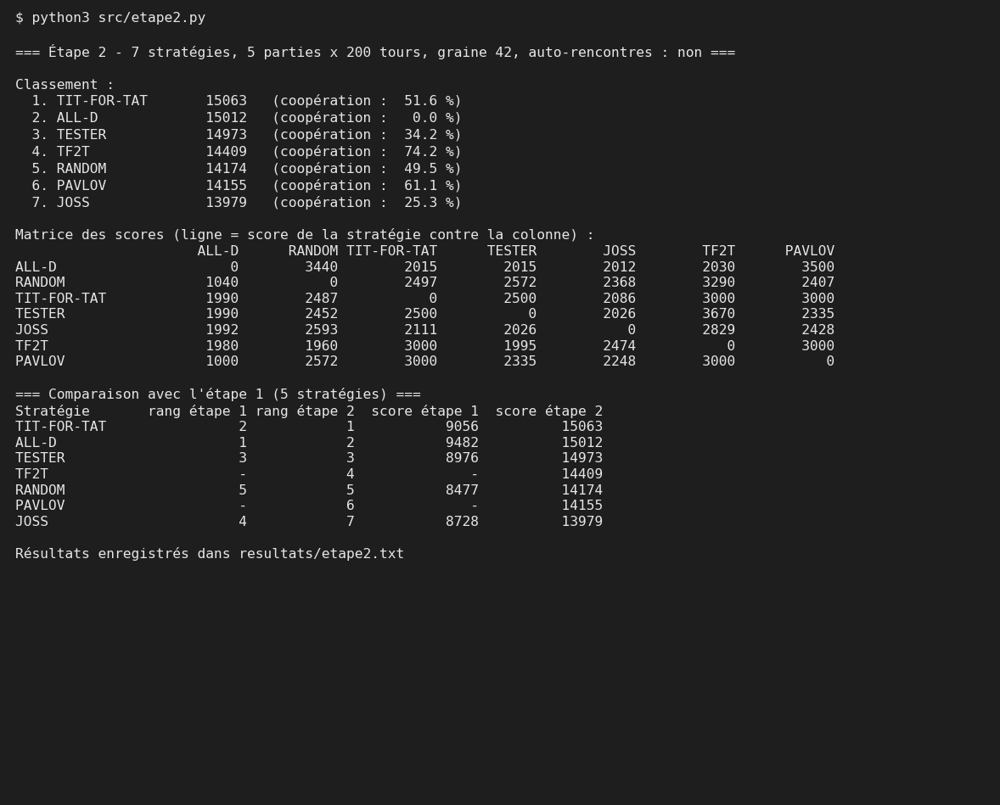
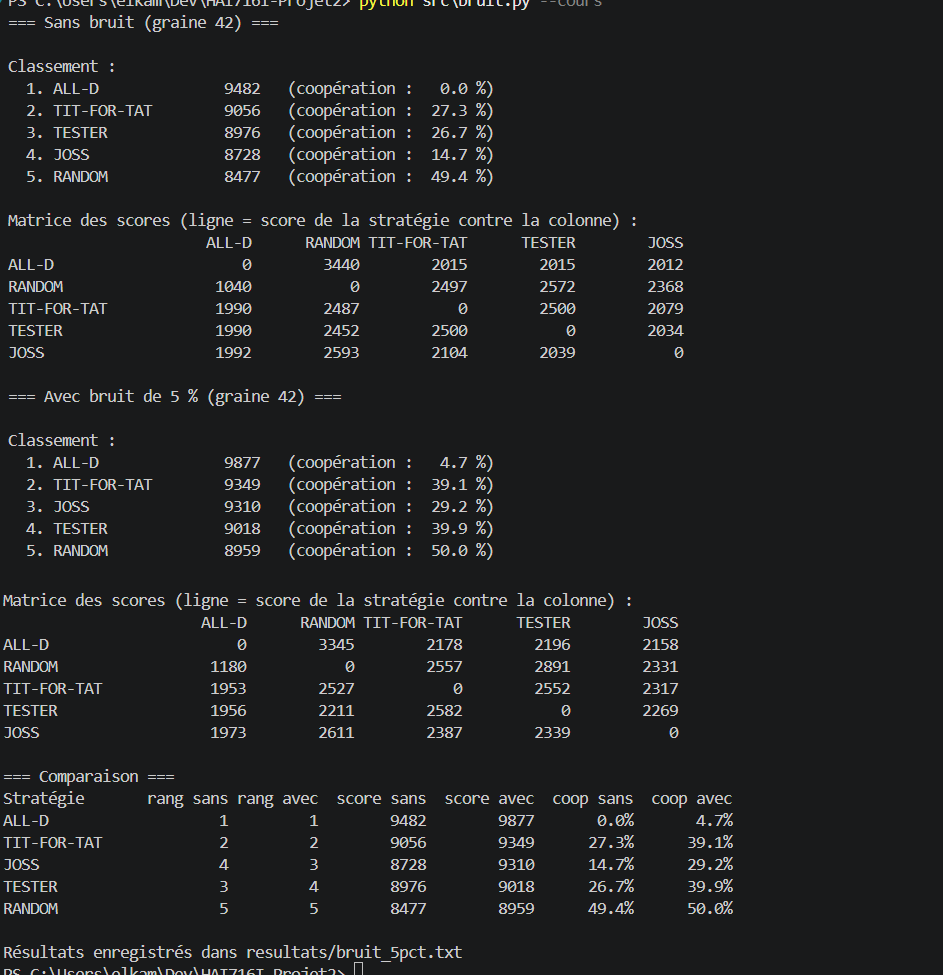
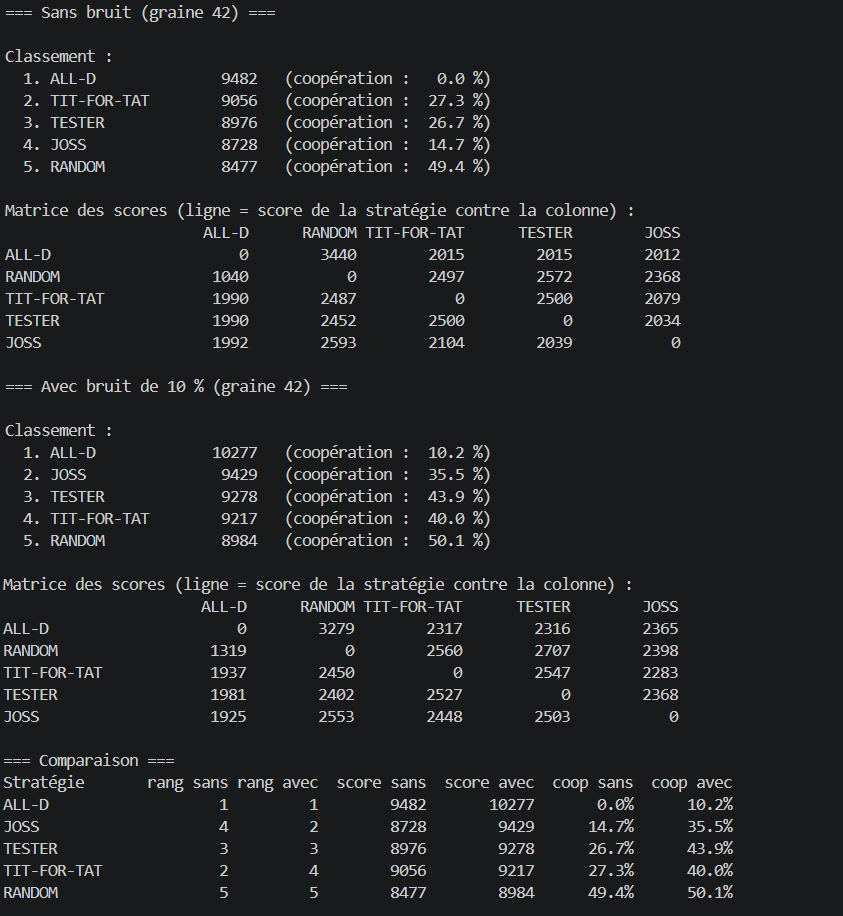
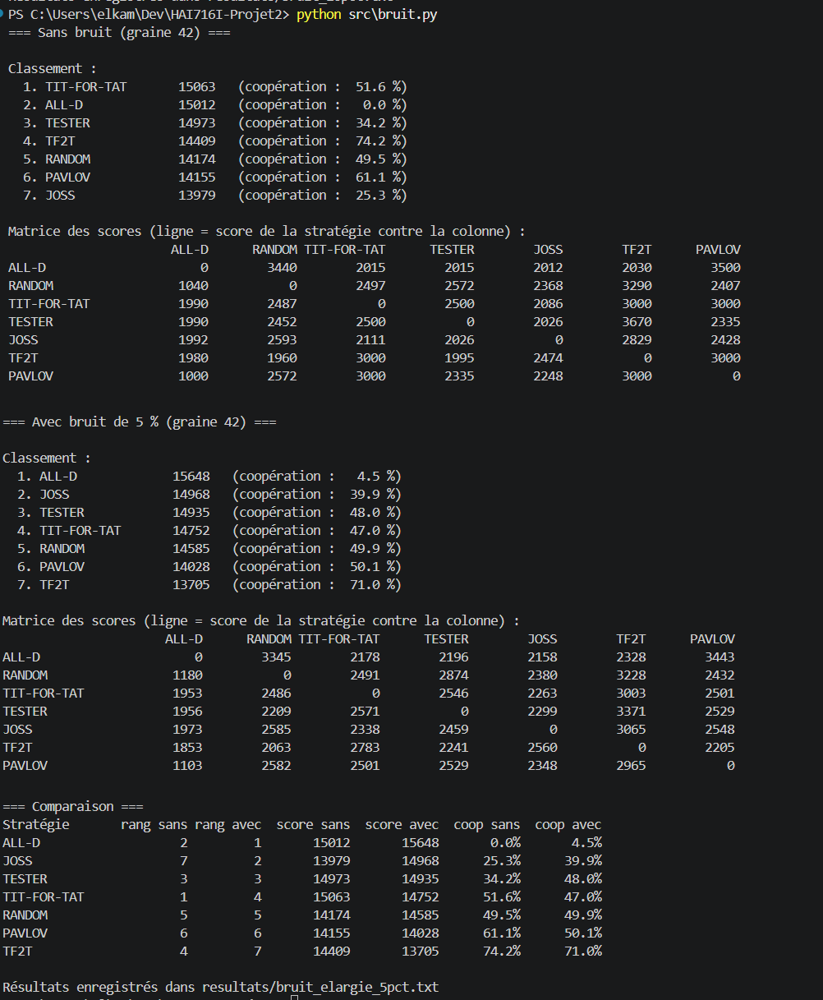
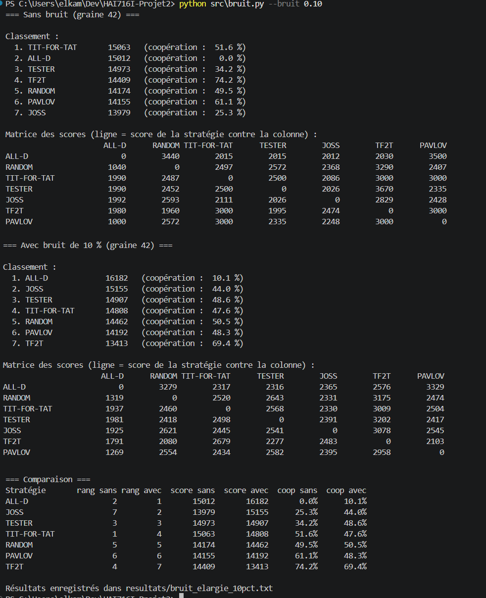
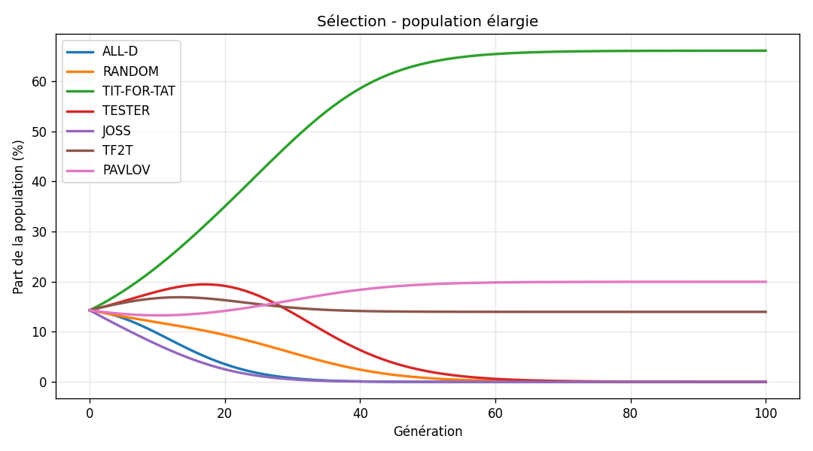
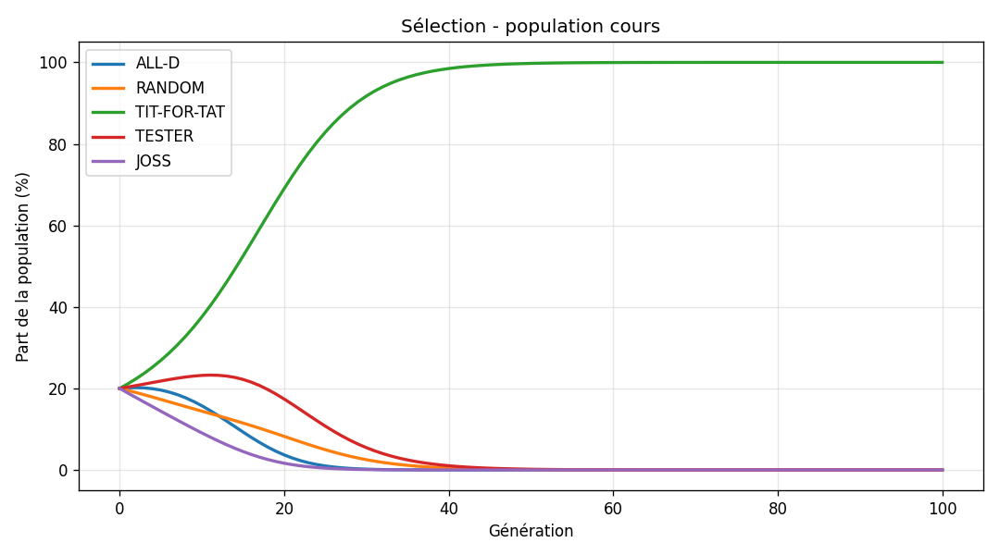

# Journal de bord – Mohamed Amine EL KAMEL

HAI716I – Projet 2 (partie 1) : tournoi du dilemme du prisonnier itéré, réalisé en binôme avec Ethan Baudrand. J'ai codé le moteur, les cinq stratégies du cours, l'étape 1 et le bruit. Ethan a codé TF2T, PAVLOV, l'étape 2 et la sélection. Les choix des stratégies et des modifications ont été faits ensemble. Ce journal couvre tout le projet, en détaillant ma partie.

## 1. Protocole et choix techniques

| Paramètre                 | Valeur retenue                                                    | Raison                                                                                                                                                                         |
| ------------------------- | ----------------------------------------------------------------- | ------------------------------------------------------------------------------------------------------------------------------------------------------------------------------ |
| Parties par confrontation | 5                                                                 | format d'Axelrod imposé par le sujet                                                                                                                                           |
| Tours par partie          | 200                                                               | format d'Axelrod imposé par le sujet                                                                                                                                           |
| Gains                     | CC = 3/3, CD = 0/5, DC = 5/0, DD = 2/2                            | matrice du cours ; c'est bien un dilemme, car 5 > 3 > 2 > 0 et 2 × 3 > 5 + 0                                                                                                   |
| Graine aléatoire          | 42, un seul générateur pour tout le programme                     | les résultats doivent être relançables à l'identique (RANDOM, JOSS et le bruit utilisent tous ce générateur)                                                                   |
| Confrontations            | chaque paire joue une fois et on compte le score des deux joueurs | jouer A contre B puis B contre A compterait deux fois le même duel                                                                                                             |
| Auto-rencontres           | non par défaut, oui avec l'option `--auto`                        | le sujet dit « chaque stratégie affronte chaque **autre** » et le mini-tournoi du cours n'en contient pas, mais Axelrod les incluait en 1980 : on garde les deux pour comparer |
| Classement                | score total décroissant                                           | règle d'Axelrod                                                                                                                                                                |

**Comment représenter une stratégie.** Une stratégie est une **fonction sans mémoire propre** : elle reçoit l'historique de ses coups, celui de l'adversaire et le générateur aléatoire, et renvoie `C` ou `D`.

- **Alternative écartée :** une classe avec des attributs (par exemple « l'adversaire m'a déjà trahi »).
- **Pourquoi :** avec une classe, il faut penser à remettre l'état à zéro avant chaque partie, sinon la mémoire d'une confrontation passe dans la suivante, ce qui fausse tout le tournoi. Avec une fonction, tout ce que sait la stratégie se déduit de l'historique de la partie en cours, donc ce bug est impossible.
- **Simultanéité :** les deux coups d'un tour sont calculés à partir des historiques des tours **précédents**, et chaque stratégie reçoit une copie des historiques. Aucune stratégie ne peut voir le coup actuel de l'autre ni modifier l'historique.

**Ce qu'on mesure :** le score total, pour le classement ; la matrice des duels, pour comprendre **d'où** viennent les points (elle sert aussi de base à la Sélection) ; le taux de coopération, car le score seul ne dit pas si une stratégie gagne en coopérant ou en exploitant. Cette mesure s'est révélée indispensable pour comprendre le bruit.

**Vérification du moteur.** Avant tout tournoi, on a vérifié le moteur sur des cas dont le résultat se calcule à la main (`python src/verifier.py`, qui contient aussi les tests de TF2T et PAVLOV ajoutés à l'étape 2). On a aussi vérifié TESTER coup par coup. Ces tests garantissent que les écarts observés ensuite viennent des stratégies et non d'un bug.

| Duel (1 partie de 200 tours)      | Attendu                                | Obtenu     |
| --------------------------------- | -------------------------------------- | ---------- |
| ALL-D contre ALL-D                | 400 / 400                              | 400 / 400  |
| TFT contre TFT                    | 600 / 600                              | 600 / 600  |
| TFT contre ALL-D                  | 398 / 403 (0 + 199 × 2 et 5 + 199 × 2) | 398 / 403  |
| ALL-C contre ALL-D                | 0 / 1000                               | 0 / 1000   |
| Deux tournois avec la même graine | résultats identiques                   | identiques |

## 2. Les cinq stratégies du cours

Les règles viennent du cours 4. Quand le cours laisse un point ouvert, on indique la convention choisie et pourquoi.

**ALL-D – toujours trahir**

- **Règle :** joue D à chaque tour.
- **Origine :** c'est la stratégie « rationnelle » de la théorie des jeux. Quand le nombre de tours est connu, on trahit au dernier tour puisqu'il n'y a plus de représailles possibles, donc aussi à l'avant-dernier, et ainsi de suite jusqu'au premier.
- **Devrait bien jouer contre :** RANDOM, qu'elle exploite chaque fois que RANDOM coopère.
- **Devrait mal jouer contre :** aucune stratégie ne la bat en duel, mais face aux stratégies qui ripostent (TFT, TESTER, JOSS), elle tombe dans D/D et ne gagne presque rien de plus que 2 points par tour.

**RANDOM – jouer au hasard**

- **Règle :** C ou D avec 50 % de chances chacun.
- **Origine :** c'est le témoin, la stratégie « sans intelligence ». Axelrod l'avait aussi ajoutée en 1980 pour la même raison.
- **Devrait bien jouer contre :** aucune en particulier. Elle ne tient pas compte de l'adversaire, donc elle ne profite que des stratégies qui la laissent trahir sans riposter.
- **Devrait mal jouer contre :** ALL-D, qui l'exploite. Elle ne peut construire aucune coopération stable.

**TIT-FOR-TAT – donnant-donnant**

- **Règle :** coopère au premier tour, puis copie le dernier coup de l'adversaire.
- **Origine :** proposée par Anatol Rapoport, gagnante du tournoi d'Axelrod de 1980.
- **Devrait bien jouer contre :** les stratégies qui coopèrent (3 points par tour pendant toute la partie).
- **Devrait mal jouer contre :** ALL-D (elle perd le premier tour), et les stratégies qui trahissent de temps en temps, avec lesquelles elle risque d'entrer dans des échos de représailles.

**TESTER – tester l'adversaire**

- **Règle du cours :** si l'adversaire riposte, jouer TIT-FOR-TAT ; sinon répéter C, C, D.
- **Origine :** règle du cours (diapositive 64).
- **Conventions choisies :** tour 1 = D ; tour 2 = C ; on considère qu'il y a « riposte » si l'adversaire joue D au tour 2, c'est-à-dire juste après notre trahison. S'il a riposté, TESTER joue TFT à partir du tour 3 ; sinon, il répète C, C, D à partir du tour 2. Une riposte est par définition une réponse à notre trahison, et la seule réponse directe possible est le coup du tour suivant.
- **Alternative écartée :** faire « s'excuser » TESTER (un C de plus avant de passer en TFT), comme dans certaines versions d'Axelrod. On a gardé la lecture littérale du cours pour ne pas inventer une règle.
- **Devrait bien jouer contre :** les stratégies qui ne punissent pas, qu'il exploite un tour sur trois.
- **Devrait mal jouer contre :** TFT, avec qui il risque l'écho.

**JOSS – TFT sournois**

- **Règle du cours :** TIT-FOR-TAT, mais remplace C par D une fois sur dix.
- **Convention choisie :** les 10 % s'appliquent à chaque tour où TFT jouerait C, **y compris le premier tour**, car c'est la lecture littérale de la règle et le cours ne prévoit aucune exception pour le premier tour.
- **Origine :** programme soumis par Johann Joss au tournoi de 1980.
- **Devrait bien jouer contre :** RANDOM, qui ne réagit pas à ses trahisons : chaque D ajouté rapporte 5 au lieu de 3 quand RANDOM coopère.
- **Devrait mal jouer contre :** TFT et toutes les stratégies réciproques, car chaque trahison surprise déclenche des représailles qui lui coûtent plus que les 5 points gagnés.

## 3. Étape 1 : tournoi de base

Commandes : `python src/etape1.py` et `python src/etape1.py --auto`, sorties dans `resultats/etape1.txt` et `resultats/etape1_auto.txt`.

| Rang | Sans auto-rencontres | Coop.  | Avec auto-rencontres | Coop.  |
| ---- | -------------------- | ------ | -------------------- | ------ |
| 1    | ALL-D – 9482         | 0,0 %  | TIT-FOR-TAT – 12042  | 41,6 % |
| 2    | TIT-FOR-TAT – 9056   | 27,3 % | TESTER – 11594       | 35,1 % |
| 3    | TESTER – 8976        | 26,7 % | ALL-D – 11482        | 0,0 %  |
| 4    | JOSS – 8728          | 14,7 % | RANDOM – 11118       | 49,8 % |
| 5    | RANDOM – 8477        | 49,4 % | JOSS – 10753         | 12,5 % |

**TIT-FOR-TAT gagne-t-il ? Non, pas dans le format du sujet : ALL-D gagne et TFT est 2e.** TFT gagne seulement si on ajoute les auto-rencontres.

1. **TFT n'a personne avec qui coopérer.** Aucun de ses adversaires ne lui permet la coopération mutuelle (3000 sur 5 parties) : son meilleur duel n'atteint que 2500.
2. **ALL-D vit de RANDOM.** Il prend 3440 points à RANDOM, contre 2487 pour TFT, et ne perd presque rien contre les trois autres.
3. **La population de 1980 était différente :** beaucoup de programmes « gentils », alors que nos cinq stratégies en comptent trois qui trahissent volontairement (ALL-D, TESTER, JOSS) et une imprévisible.
4. **Axelrod comptait les auto-rencontres.** Avec `--auto`, TFT gagne 3000 contre sa copie, ALL-D seulement 2000 : TFT passe devant.

**Conclusion :** le succès de TFT n'est pas absolu. Il dépend de la population : TFT ne gagne que s'il y a assez de stratégies avec qui coopérer.

**L'écho entre TFT et TESTER.** Le duel TFT contre TESTER donne exactement 2500 à chacun, ce qui ne peut pas être un hasard. Tour par tour, TESTER joue D, C, D, C… et TFT joue C, D, C, D… : TFT riposte au tour 2 ; TESTER passe alors en TFT et copie cette riposte ; TFT copie la copie… Chacune gagne 5 puis 0, soit 2,5 points par tour en moyenne : 500 par partie et 2500 sur 5 parties. C'est l'**écho de représailles** : deux stratégies réciproques peuvent se punir à tour de rôle indéfiniment. Il vient directement de notre lecture littérale de TESTER, qui passe en TFT sans geste de réconciliation. Ce défaut a orienté notre choix de nouvelles stratégies à l'étape 2.

## 4. Étape 2 : deux nouvelles stratégies

Le choix a été fait ensemble avec Ethan, qui les a programmées. Plutôt que d'ajouter des stratégies au hasard, on a voulu **répondre aux deux faiblesses observées à l'étape 1** : l'écho de représailles et la fragilité face aux erreurs.

**TIT-FOR-TWO-TATS (TF2T) – contre l'écho**

- **Règle :** coopère, et ne trahit que si l'adversaire a trahi **aux deux derniers tours**.
- **Origine :** Axelrod a remarqué après coup que cette stratégie aurait gagné son premier tournoi si quelqu'un l'avait proposée.
- **Pourquoi elle :** elle ignore une trahison isolée, donc elle ne peut pas lancer d'écho. Contre JOSS ou TESTER, une trahison seule ne déclenche pas de représailles en chaîne.
- **Faiblesse attendue :** elle est exploitable. Le cycle C, C, D de TESTER ne contient jamais deux D d'affilée : TF2T ne riposte donc jamais, et TESTER prend 5 points un tour sur trois.

**PAVLOV (Win-Stay, Lose-Shift) – contre les erreurs**

- **Règle :** coopère au premier tour. Ensuite, si le tour précédent lui a rapporté 3 ou 5 points (« gagné »), elle rejoue le même coup ; s'il lui a rapporté 0 ou 2 (« perdu »), elle change de coup.
- **Origine :** décrite par Kraines et Kraines (1989), puis rendue célèbre par Nowak et Sigmund (1993), qui ont montré qu'elle fait mieux que TFT dans un environnement avec erreurs.
- **Pourquoi elle :** elle sait **revenir à la coopération** après une erreur. Si deux PAVLOV coopèrent et que l'une trahit par erreur, celle qui a trahi a gagné 5 et continue de trahir, celle qui a perdu change et trahit aussi. Au tour suivant, D/D rapporte 2 aux deux, donc les deux changent et reviennent à C. La coopération revient en deux tours, alors que TFT entrerait en écho.
- **Faiblesse attendue :** contre ALL-D, elle alterne C et D (après D/D elle change pour C, prend 0, change pour D…). Elle ne gagne que 1 point par tour en moyenne, contre 2 pour TFT.

**Stratégies écartées :** ALL-C, qui ne ferait que nourrir ALL-D ; GRIM TRIGGER, car une seule trahison de JOSS casserait toute la partie ; le TFT généreux, mentionné dans le cours, donc qui risquait de ne pas compter comme « absent du cours ».

**Résultats.** Commande : `python src/etape2.py`, sortie dans `resultats/etape2.txt`. Les totaux ne se comparent pas à ceux de l'étape 1, car chaque stratégie a 6 adversaires au lieu de 4.

| Rang | Stratégie   | Score | Coop.  | Rang à l'étape 1 |
| ---- | ----------- | ----- | ------ | ---------------- |
| 1    | TIT-FOR-TAT | 15063 | 51,6 % | 2                |
| 2    | ALL-D       | 15012 | 0,0 %  | 1                |
| 3    | TESTER      | 14973 | 34,2 % | 3                |
| 4    | TF2T        | 14409 | 74,2 % | –                |
| 5    | RANDOM      | 14174 | 49,5 % | 5                |
| 6    | PAVLOV      | 14155 | 61,1 % | –                |
| 7    | JOSS        | 13979 | 25,3 % | 4                |

**Prédictions (écrites avant le tournoi) et vérification :**

1. _Contre ALL-D, sur une partie : TF2T 396 / ALL-D 406, et PAVLOV environ 200 / ALL-D environ 700._ **Juste :** sur 5 parties, TF2T fait 1980 contre ALL-D (5 × 396) et PAVLOV 1000 (5 × 200), contre 2030 et 3500 pour ALL-D.
2. _TF2T, PAVLOV et TFT coopèrent pleinement entre elles, et le score de TFT monte nettement._ **Juste :** elles marquent 3000 des deux côtés dans chacun de leurs trois duels : TFT trouve enfin des partenaires.
3. _TESTER exploite TF2T et monte au classement._ **À moitié juste :** TESTER exploite bien TF2T (3670 contre 1995), mais reste 3e, plombé par l'écho avec TFT (2500).
4. _ALL-D perd la 1re place._ **Juste, de justesse :** TFT finit 1er avec 51 points d'avance, un écart fragile avec une seule graine. On n'avait pas prévu que PAVLOV serait une nouvelle victime d'ALL-D : il lui prend 3500 points, plus qu'à RANDOM (3440), parce que PAVLOV revient à C après chaque D/D.

**Bilan.** Les deux nouvelles stratégies ne gagnent pas elles-mêmes (4e et 6e). Leur effet principal est de donner à TFT les partenaires qui lui manquaient.

## 5. Étape 3 – Modification 1 : le bruit

**Pourquoi cette modification :**

- **Le bruit teste directement la faiblesse qu'on a trouvée à l'étape 1 :** L'écho TFT/TESTER montre que les stratégies réciproques sont sensibles à une trahison isolée. Le bruit en crée partout : on peut mesurer à quel point chaque stratégie y résiste.
- **C'est la modification la plus réaliste :** dans une vraie interaction, les erreurs et les malentendus existent.
- **Pourquoi pas l'horizon inconnu :** aucune de nos stratégies ne compte les tours ni ne change de comportement à l'approche du 200e. Rendre la fin incertaine ne changerait donc presque rien, et l'expérience serait peu informative.

**Modèle retenu.** Chaque coup choisi est inversé avec une probabilité p. Le coup inversé est **réellement joué** : il compte dans les gains et c'est lui que l'adversaire voit.

- **Alternative écartée :** une erreur de perception, où seul l'adversaire voit le mauvais coup (version de la diapositive 72 du cours).
- **Pourquoi :** le sujet parle de coups « inversés ». De plus, avec notre modèle, les deux joueurs ont le même historique de la partie. Avec une erreur de perception, chacun aurait sa propre version de l'historique, ce qui demanderait de changer le moteur en profondeur.

Commandes : `python src/bruit.py --cours` (5 %) et `python src/bruit.py --cours --bruit 0.10` (10 %), ou `--population cours` à la place de `--cours`. Sorties dans `resultats/bruit_5pct.txt` et `resultats/bruit_10pct.txt`.

**Premier essai à 5 % : observation exploratoire.** Ce lancement a d'abord servi à tester le script, avant qu'une prédiction soit écrite. C'est lui qui a guidé la vraie prédiction, faite ensuite pour 10 %.

**Surprise :** l'idée du cours est que le bruit détruit la coopération. On observe l'inverse : la coopération **monte** pour toutes les stratégies, et tous les scores aussi. **Explication :** le bruit ne détruit que la coopération qui existe. Sans bruit, notre population n'en a presque pas : elle est bloquée soit en D/D (contre ALL-D), soit dans des échos C/D (TFT contre TESTER ou JOSS). Une erreur peut **débloquer** ces situations : si celui qui devait jouer D dans un écho joue C par erreur, les deux se retrouvent en C/C et y restent jusqu'à la prochaine erreur. TFT contre JOSS passe ainsi de 2079 à 2317.

**Prédiction pour 10 % (écrite avant le lancement) :**

1. ALL-D coopérera environ 10 % du temps, uniquement à cause du bruit.
2. L'effet de déblocage va continuer : la coopération de TFT, TESTER et JOSS va encore monter.
3. ALL-D restera 1er, mais son avance sur le 2e va diminuer, car le bruit aide les stratégies réciproques à sortir des échos.

| Stratégie   | Rang sans → 5 % → 10 % | Score sans → 5 % → 10 % | Coop. sans → 5 % → 10 % |
| ----------- | ---------------------- | ----------------------- | ----------------------- |
| ALL-D       | 1 → 1 → 1              | 9482 → 9877 → 10277     | 0,0 → 4,7 → 10,2 %      |
| JOSS        | 4 → 3 → 2              | 8728 → 9310 → 9429      | 14,7 → 29,2 → 35,5 %    |
| TESTER      | 3 → 4 → 3              | 8976 → 9018 → 9278      | 26,7 → 39,9 → 43,9 %    |
| TIT-FOR-TAT | 2 → 2 → 4              | 9056 → 9349 → 9217      | 27,3 → 39,1 → 40,0 %    |
| RANDOM      | 5 → 5 → 5              | 8477 → 8959 → 8984      | 49,4 → 50,0 → 50,1 %    |

- **Juste :** ALL-D coopère à 10,2 % et reste 1er. La coopération de TESTER et JOSS continue de monter.
- **Faux :** l'avance d'ALL-D **augmente** au lieu de diminuer (848 points sur le 2e, contre 528 à 5 %). Surtout, **TFT s'effondre de la 2e à la 4e place**, et sa coopération stagne.

**Explication de l'écart.** On avait sous-estimé un effet : **TFT réagit mécaniquement à chaque erreur, dans les deux sens.**

- **Contre ALL-D :** quand ALL-D joue C par erreur, TFT le copie au tour suivant et joue C contre un D : il prend 0. TFT contre ALL-D passe de 1990 sans bruit à 1953 à 5 % et 1937 à 10 %, tandis qu'ALL-D contre TFT monte de 2015 à 2317.
- **Contre JOSS :** à 10 %, les trahisons volontaires de JOSS se noient dans le bruit. TFT punit tout autant les vraies trahisons que les erreurs. JOSS contre TFT monte à 2448 pendant que TFT contre JOSS descend à 2283. JOSS garde le bénéfice de l'exploitation sans en payer le prix, et monte à la 2e place.
- **Bilan :** à 5 %, l'effet de déblocage dominait. À 10 %, c'est l'effet d'exploitation qui l'emporte. **Le bruit révèle que TFT est trop rigide :** il ne sait pas faire la différence entre une erreur et une trahison. C'est exactement le défaut que PAVLOV et TF2T sont censées corriger.

**Le bruit avec les 7 stratégies.** Commandes : `python src/bruit.py` et `python src/bruit.py --bruit 0.10`, sorties dans `resultats/bruit_elargie_5pct.txt` et `resultats/bruit_elargie_10pct.txt`. Ce n'est pas une prédiction à l'aveugle (les sorties étaient déjà dans le dépôt) : on s'en sert pour tester l'explication « le bruit ne détruit que la coopération qui existe ». **Elle tient :** avec 7 stratégies, TFT perd des points dès 5 % (15063 → 14752), car il coopère maintenant pleinement avec TF2T et PAVLOV. La perte vient de PAVLOV (3000 → 2501) : une seule erreur lance un cycle de 3 tours où chacune marque 7 points, soit 2,33 par tour au lieu de 3 (vérifié coup par coup). Contre TF2T, rien ne bouge (3000 → 3003), car TF2T ignore une trahison isolée.

## 6. Étape 3 – Modification 2 : la sélection

Le choix a été fait ensemble avec Ethan, qui l'a programmée. **Pourquoi cette modification.** Le classement de l'étape 1 est une photo : il dit qui gagne le plus de points **une fois**. Il ne dit pas si cette victoire peut **durer**. ALL-D gagne surtout grâce à RANDOM. Si les stratégies qui gagnent se multiplient et que les autres disparaissent, ALL-D risque de perdre ses victimes. La sélection permet de tester ça, comme dans le tournoi « écologique » d'Axelrod.

**Modèle retenu.**

- On part d'une population où chaque stratégie a la même part.
- À chaque génération, le score d'une stratégie est la moyenne de ses scores contre chaque stratégie, pondérée par la part de cette stratégie dans la population. Les scores viennent de la matrice des duels.
- La nouvelle part d'une stratégie = son ancienne part × son score / le score moyen de la population. Les stratégies au-dessus de la moyenne grandissent, les autres diminuent.
- **On utilise la matrice avec auto-rencontres :** dans une population, les membres d'une même stratégie se rencontrent entre eux.

**Prédiction (écrite avant le lancement) :**

1. Au début, ALL-D grandit, car il est le meilleur contre RANDOM, qui représente encore une grosse part de la population.
2. RANDOM disparaît vite, car c'est la stratégie la plus faible.
3. Une fois RANDOM disparu, ALL-D n'a plus personne à exploiter : il rencontre surtout des stratégies qui ripostent et lui-même (2 points par tour). Il décline.
4. À la fin, ce sont les stratégies réciproques (TFT, TESTER et les nouvelles) qui dominent.

**Résultats.** Commandes : `python src/selection.py` (7 stratégies) et `python src/selection.py --population cours` (5 stratégies du cours), 100 générations. Sorties dans `resultats/selection_elargie.txt` et `resultats/selection_cours.txt`.

**Parts finales :** avec les 7 stratégies, TFT 66,07 %, PAVLOV 19,97 %, TF2T 13,97 %, et 0 % pour les autres. Avec les 5 du cours, TFT finit seul à 100 %. Les parts ne bougent plus, car les trois survivantes marquent 3000 entre elles et contre leur propre copie.

1. **ALL-D grandit au début : vrai seulement avec les 5 du cours, et à peine** (20,00 % → 20,19 % à la génération 2, puis baisse). Avec 7 stratégies, il est sous la moyenne dès le départ.
2. **RANDOM disparaît vite : faux.** C'est JOSS qui disparaît la première : à la génération 30, RANDOM est encore à 5,78 %, contre 0,74 % pour ALL-D et 0,50 % pour JOSS.
3. **ALL-D décline : l'issue est juste, la raison est fausse.** Il passe sous 1 % alors que RANDOM est encore présent, parce que TFT se multiplie : chaque TFT ne lui rapporte qu'environ 2015 points, alors que TFT en marque 3000 contre sa propre copie.
4. **Les stratégies réciproques dominent : à moitié juste.** TFT, PAVLOV et TF2T survivent, mais TESTER disparaît : l'écho avec TFT le bloque à 2500 dans une population où TFT est majoritaire.

## 7. Impasses et corrections

- **Lectures littérales du cours :** TESTER passe en TFT sans geste de réconciliation, ce qui crée un écho permanent avec TFT, et les 10 % de JOSS s'appliquent dès le premier tour. On n'a pas « corrigé » le cours ; on a analysé l'effet de l'écho et on y a répondu à l'étape 2 avec TF2T.
- **Prédiction du bruit :** le premier lancement à 5 % a été fait avant d'écrire une prédiction. On l'a traité comme une observation exploratoire, et on a fait une vraie prédiction pour 10 % avant de lancer ce tournoi.
- **Erreur d'import (`ImportError`) :** `bruit.py` utilise aussi les stratégies d'Ethan. Tant que son fichier était vide, le script plantait. On a placé un dictionnaire vide dans `strategies_nouvelles.py`, pour que chaque partie du projet fonctionne sans attendre l'autre.
- **`bruit.py` ne redonnait plus nos chiffres à 5 stratégies :** il jouait automatiquement à 7 et écrasait `resultats/bruit_5pct.txt`. On a ajouté l'option `--population cours` (raccourci : `--cours`) et séparé les fichiers de sortie (`bruit_
pct.txt` et `bruit_elargie_
pct.txt`). Les deux options redonnent exactement nos fichiers.
- **Limite du générateur unique :** ajouter une stratégie change l'ordre des tirages, donc les duels impliquant RANDOM ou JOSS varient légèrement d'un tournoi à l'autre (TFT contre RANDOM vaut 2487 sans auto-rencontres et 2484 avec). Ces écarts sont faibles devant ceux qu'on analyse.

## 8. Conclusion

- **TFT ne gagne pas « par nature » :** dans notre tournoi de base, ALL-D gagne, car la population ne contient pas assez de stratégies coopératives. TFT ne gagne qu'avec les auto-rencontres, comme en 1980.
- **La réciprocité stricte a deux défauts :** l'écho de représailles (TFT contre TESTER) et l'incapacité à distinguer une erreur d'une trahison (TFT avec du bruit à 10 %).
- **Le bruit a un double effet, qu'on n'avait pas prévu :** quand il n'y a pas de coopération, il en crée en débloquant les échos ; quand il y en a, ou à plus forte dose, il la détruit et permet aux stratégies opportunistes d'exploiter les stratégies rigides.
- **TF2T et PAVLOV ne gagnent pas elles-mêmes**, mais elles donnent à TFT les partenaires qui lui manquaient. Avec la sélection, la victoire d'ALL-D ne dure pas : il ne reste que des stratégies qui coopèrent entre elles.
- **Aucune stratégie n'est la meilleure dans l'absolu :** le 1er change avec la population, les auto-rencontres, le bruit et la sélection. Toutes ces conclusions reposent sur une seule graine (42).
