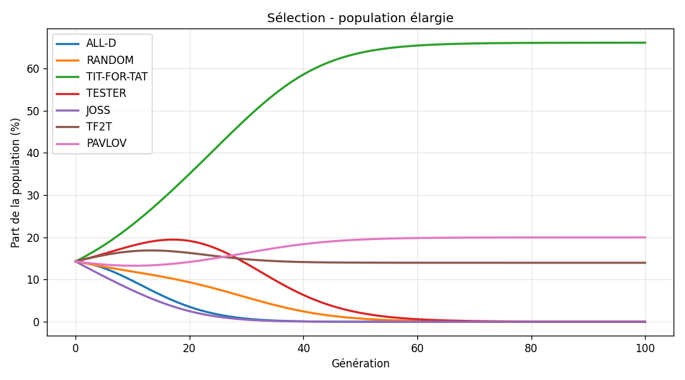

# Journal de bord – Mohamed Amine EL KAMEL et Ethan Baudrand

HAI716I – Projet 2 (partie 1) : tournoi du dilemme du prisonnier itéré, réalisé en binôme avec Ethan.

---

## 1. Protocole et choix techniques

### Paramètres du tournoi

| Paramètre                 | Valeur retenue                                                    | Raison                                                                                                                                                                         |
| ------------------------- | ----------------------------------------------------------------- | ------------------------------------------------------------------------------------------------------------------------------------------------------------------------------ |
| Parties par confrontation | 5                                                                 | format d'Axelrod imposé par le sujet                                                                                                                                           |
| Tours par partie          | 200                                                               | format d'Axelrod imposé par le sujet                                                                                                                                           |
| Gains                     | CC = 3/3, CD = 0/5, DC = 5/0, DD = 2/2                            | matrice du cours ; c'est bien un dilemme, car 5 > 3 > 2 > 0 et 2 × 3 > 5 + 0                                                                                                   |
| Graine aléatoire          | 42, un seul générateur pour tout le programme                     | les résultats doivent être relançables à l'identique (RANDOM, JOSS et le bruit utilisent tous ce générateur)                                                                   |
| Confrontations            | chaque paire joue une fois et on compte le score des deux joueurs | jouer A contre B puis B contre A compterait deux fois le même duel                                                                                                             |
| Auto-rencontres           | non par défaut, oui avec l'option `--auto`                        | le sujet dit « chaque stratégie affronte chaque **autre** » et le mini-tournoi du cours n'en contient pas, mais Axelrod les incluait en 1980 : on garde les deux pour comparer |
| Classement                | score total décroissant                                           | règle d'Axelrod                                                                                                                                                                |

### Comment représenter une stratégie

Une stratégie est une **fonction sans mémoire propre** : elle reçoit l'historique de ses coups, celui de l'adversaire et le générateur aléatoire, et renvoie `C` ou `D`.

- **Alternative écartée :** une classe avec des attributs (par exemple « l'adversaire m'a déjà trahi »).
- **Pourquoi :** avec une classe, il faut penser à remettre l'état à zéro avant chaque partie, sinon la mémoire d'une confrontation passe dans la suivante, ce qui fausse tout le tournoi. Avec une fonction, tout ce que sait la stratégie se déduit de l'historique de la partie en cours, donc ce bug est impossible.
- **Simultanéité :** les deux coups d'un tour sont calculés à partir des historiques des tours **précédents**, et chaque stratégie reçoit une copie des historiques. Aucune stratégie ne peut voir le coup actuel de l'autre ni modifier l'historique.

### Ce qu'on mesure

- **Le score total**, pour le classement.
- **La matrice des duels** (score de chaque stratégie contre chaque autre), pour comprendre **d'où** viennent les points. Elle sert aussi de base à la Sélection.
- **Le taux de coopération** de chaque stratégie. Le score seul ne dit pas si une stratégie gagne en coopérant ou en exploitant. Cette mesure s'est révélée indispensable pour comprendre le bruit.

### Vérification du moteur

Avant tout tournoi, on a vérifié le moteur sur des cas dont le résultat se calcule à la main :

| Duel (1 partie de 200 tours)      | Attendu                                | Obtenu     |
| --------------------------------- | -------------------------------------- | ---------- |
| ALL-D contre ALL-D                | 400 / 400                              | 400 / 400  |
| TFT contre TFT                    | 600 / 600                              | 600 / 600  |
| TFT contre ALL-D                  | 398 / 403 (0 + 199 × 2 et 5 + 199 × 2) | 398 / 403  |
| ALL-C contre ALL-D                | 0 / 1000                               | 0 / 1000   |
| Deux tournois avec la même graine | résultats identiques                   | identiques |

On a aussi vérifié TESTER coup par coup (voir plus bas). Ces tests garantissent que les écarts observés ensuite viennent des stratégies et non d'un bug.

---

## 2. Les cinq stratégies du cours

Les règles viennent du cours 4. Quand le cours laisse un point ouvert, on indique la convention choisie et pourquoi.

### ALL-D – toujours trahir

- **Règle :** joue D à chaque tour.
- **Rôle dans le tournoi :** c'est le cas extrême de l'égoïsme. Elle mesure jusqu'où on peut gagner sans jamais coopérer.
- **Devrait bien jouer contre :** RANDOM, qu'elle exploite chaque fois que RANDOM coopère.
- **Devrait mal jouer contre :** aucune stratégie ne la bat en duel, mais face aux stratégies qui ripostent (TFT, TESTER, JOSS), elle tombe dans D/D et ne gagne presque rien de plus que 2 points par tour.

### RANDOM – jouer au hasard

- **Règle :** C ou D avec 50 % de chances chacun.
- **Rôle :** c'est le témoin, la stratégie « sans intelligence ». Axelrod l'avait aussi ajoutée en 1980 pour la même raison.
- **Devrait mal jouer contre :** ALL-D, qui l'exploite. Elle ne peut construire aucune coopération stable.

### TIT-FOR-TAT – donnant-donnant

- **Règle :** coopère au premier tour, puis copie le dernier coup de l'adversaire.
- **Origine :** proposée par Anatol Rapoport, gagnante du tournoi d'Axelrod de 1980.
- **Rôle :** c'est la stratégie de référence du sujet. Elle est gentille (ne trahit jamais en premier), elle punit immédiatement et elle pardonne immédiatement.
- **Devrait bien jouer contre :** les stratégies qui coopèrent (3 points par tour pendant toute la partie).
- **Devrait mal jouer contre :** ALL-D (elle perd le premier tour), et les stratégies qui trahissent de temps en temps, avec lesquelles elle risque d'entrer dans des échos de représailles.

### TESTER – tester l'adversaire

- **Règle du cours :** si l'adversaire riposte, jouer TIT-FOR-TAT ; sinon répéter C, C, D.
- **Conventions choisies :** tour 1 = D ; tour 2 = C ; on considère qu'il y a « riposte » si l'adversaire joue D au tour 2, c'est-à-dire juste après notre trahison. S'il a riposté, TESTER joue TFT à partir du tour 3 ; sinon, il répète C, C, D à partir du tour 2.
- **Pourquoi :** une riposte est par définition une réponse à notre trahison, et la seule réponse directe possible est le coup du tour suivant. Juger sur un tour plus tardif confondrait riposte et trahison spontanée.
- **Alternative écartée :** faire « s'excuser » TESTER (un C de plus avant de passer en TFT), comme dans certaines versions d'Axelrod. On a gardé la lecture littérale du cours pour ne pas inventer une règle, et on a observé ses conséquences (étape 1).
- **Devrait bien jouer contre :** les stratégies qui ne punissent pas, qu'il exploite un tour sur trois.
- **Devrait mal jouer contre :** TFT, avec qui il risque l'écho.

### JOSS – TFT sournois

- **Règle du cours :** TIT-FOR-TAT, mais remplace C par D une fois sur dix.
- **Convention choisie :** les 10 % s'appliquent à chaque tour où TFT jouerait C, **y compris le premier tour**.
- **Pourquoi :** c'est la lecture littérale de la règle, et le cours ne prévoit aucune exception pour le premier tour.
- **Origine :** programme soumis par Johann Joss au tournoi de 1980.
- **Rôle :** il montre ce que coûte une petite dose de trahison dans une stratégie réciproque.
- **Devrait mal jouer contre :** TFT et toutes les stratégies réciproques, car chaque trahison surprise déclenche des représailles qui lui coûtent plus que les 5 points gagnés.

---

## 3. Étape 1 : tournoi de base

| Rang | Sans auto-rencontres | Coop.  | Avec auto-rencontres | Coop.  |
| ---- | -------------------- | ------ | -------------------- | ------ |
| 1    | ALL-D – 9482         | 0,0 %  | TIT-FOR-TAT – 12042  | 41,6 % |
| 2    | TIT-FOR-TAT – 9056   | 27,3 % | TESTER – 11594       | 35,1 % |
| 3    | TESTER – 8976        | 26,7 % | ALL-D – 11482        | 0,0 %  |
| 4    | JOSS – 8728          | 14,7 % | RANDOM – 11118       | 49,8 % |
| 5    | RANDOM – 8477        | 49,4 % | JOSS – 10753         | 12,5 % |

Matrice des duels sans auto-rencontres (score de la ligne contre la colonne, sur 5 parties) :

|            | ALL-D | RANDOM | TFT  | TESTER | JOSS |
| ---------- | ----- | ------ | ---- | ------ | ---- |
| **ALL-D**  | –     | 3440   | 2015 | 2015   | 2012 |
| **RANDOM** | 1040  | –      | 2497 | 2572   | 2368 |
| **TFT**    | 1990  | 2487   | –    | 2500   | 2079 |
| **TESTER** | 1990  | 2452   | 2500 | –      | 2034 |
| **JOSS**   | 1992  | 2593   | 2104 | 2039   | –    |

### TIT-FOR-TAT gagne-t-il ?

**Non, pas dans le format du sujet : ALL-D gagne et TFT est 2e.** TFT gagne seulement si on ajoute les auto-rencontres.

**Pourquoi ce résultat diffère de 1980 :**

1. **TFT n'a personne avec qui coopérer.** Elle gagne ses points grâce à la coopération mutuelle à 3 points par tour, soit 3000 sur 5 parties. Ici, aucun de ses adversaires ne lui permet ça : ALL-D trahit toujours, RANDOM est imprévisible, JOSS trahit par surprise et TESTER entre en écho avec elle. Son meilleur duel n'atteint que 2500.
2. **ALL-D vit de RANDOM.** Il prend 3440 points à RANDOM, contre 2487 pour TFT face à la même stratégie. Contre les trois autres, il ne perd presque rien (environ 2015 chacun, soit à peine plus que D/D toute la partie). Ces 950 points d'avance sur RANDOM suffisent à le mettre 1er.
3. **La population de 1980 était différente.** Il y avait 14 programmes, dont beaucoup de « gentils », qui ne trahissent jamais en premier. TFT coopérait pleinement avec eux. Nos cinq stratégies comptent au contraire trois stratégies qui trahissent volontairement (ALL-D, TESTER, JOSS) et une imprévisible.
4. **Axelrod comptait les auto-rencontres.** Avec `--auto`, TFT gagne 3000 contre sa copie, alors qu'ALL-D ne gagne que 2000 contre la sienne. Ces 1000 points d'écart suffisent à faire passer TFT devant ALL-D.

**Conclusion :** le succès de TFT n'est pas absolu. Il dépend de la population : TFT ne gagne que s'il y a assez de stratégies avec qui coopérer.

### L'écho entre TFT et TESTER

Le duel TFT contre TESTER donne exactement 2500 à chacun, ce qui ne peut pas être un hasard. Tour par tour :

| Tour   | 1   | 2   | 3   | 4   | 5   | …   |
| ------ | --- | --- | --- | --- | --- | --- |
| TESTER | D   | C   | D   | C   | D   | …   |
| TFT    | C   | D   | C   | D   | C   | …   |

TFT riposte au tour 2 ; TESTER passe alors en TFT et copie cette riposte ; TFT copie la copie… Les deux stratégies jouent toujours en décalé. Chacune gagne 5 puis 0, soit 2,5 points par tour en moyenne : 500 par partie et 2500 sur 5 parties.

C'est l'**écho de représailles** : deux stratégies réciproques peuvent se punir à tour de rôle indéfiniment. Il vient directement de notre lecture littérale de TESTER, qui passe en TFT sans geste de réconciliation. Ce défaut a orienté notre choix de nouvelles stratégies à l'étape 2.

---

## 4. Étape 2 : deux nouvelles stratégies

Le choix a été fait ensemble avec Ethan, qui les a programmées. Plutôt que d'ajouter des stratégies au hasard, on a voulu **répondre aux deux faiblesses observées à l'étape 1** : l'écho de représailles et la fragilité face aux erreurs.

### TIT-FOR-TWO-TATS (TF2T) – contre l'écho

- **Règle :** coopère, et ne trahit que si l'adversaire a trahi **aux deux derniers tours**.
- **Origine :** Axelrod a remarqué après coup que cette stratégie aurait gagné son premier tournoi si quelqu'un l'avait proposée.
- **Pourquoi elle :** elle ignore une trahison isolée, donc elle ne peut pas lancer d'écho. Contre JOSS ou TESTER, une trahison seule ne déclenche pas de représailles en chaîne.
- **Faiblesse attendue :** elle est exploitable. Le cycle C, C, D de TESTER ne contient jamais deux D d'affilée : TF2T ne riposte donc jamais, et TESTER prend 5 points un tour sur trois.

### PAVLOV (Win-Stay, Lose-Shift) – contre les erreurs

- **Règle :** coopère au premier tour. Ensuite, si le tour précédent lui a rapporté 3 ou 5 points (« gagné »), elle rejoue le même coup ; s'il lui a rapporté 0 ou 2 (« perdu »), elle change de coup.
- **Origine :** décrite par Kraines et Kraines (1989), puis rendue célèbre par Nowak et Sigmund (1993), qui ont montré qu'elle fait mieux que TFT dans un environnement avec erreurs.
- **Pourquoi elle :** elle sait **revenir à la coopération** après une erreur. Si deux PAVLOV coopèrent et que l'une trahit par erreur, celle qui a trahi a gagné 5 et continue de trahir, celle qui a perdu change et trahit aussi. Au tour suivant, D/D rapporte 2 aux deux, donc les deux changent et reviennent à C. La coopération revient en deux tours, alors que TFT entrerait en écho.
- **Faiblesse attendue :** contre ALL-D, elle alterne C et D (après D/D elle change pour C, prend 0, change pour D…). Elle ne gagne que 1 point par tour en moyenne, contre 2 pour TFT.

### Stratégies écartées

- **ALL-C (toujours coopérer) :** trop simple, et elle ne ferait que nourrir ALL-D.
- **GRIM TRIGGER (punir pour toujours après la première trahison) :** c'est l'inverse de ce qu'on cherche, car une seule trahison de JOSS casserait toute la partie.
- **TFT généreux :** il est mentionné dans le cours, donc il risquait de ne pas compter comme « absent du cours ».

### Prédictions

1. Contre ALL-D, sur une partie : TF2T 396 / ALL-D 406 (elle coopère deux fois avant de riposter), et PAVLOV environ 200 / ALL-D environ 700 (alternance C/D).
2. TF2T, PAVLOV et TFT coopèrent pleinement entre elles (3 points par tour), ce qui donne enfin à TFT des partenaires : son score devrait monter nettement.
3. TESTER devrait exploiter TF2T et monter au classement.
4. ALL-D devrait perdre la 1re place, car les nouvelles stratégies coopératives profitent surtout aux stratégies réciproques.

### Résultats et comparaison avec l'étape 1

Avant le tournoi, on a vérifié les deux stratégies avec six tests calculés à la main, ajoutés à `verifier.py`. Par exemple, TF2T contre ALL-D doit donner 396 / 406.

Commande : `python3 src/etape2.py`, sortie dans `resultats/etape2.txt`.

Chaque stratégie a maintenant 6 adversaires au lieu de 4. On compare donc la moyenne par adversaire, pas le total.

| Stratégie   | Rang étape 1 → 2 | Moyenne par adversaire 1 → 2 |
| ----------- | ---------------- | ---------------------------- |
| TIT-FOR-TAT | 2 → 1            | 2264 → 2511                  |
| ALL-D       | 1 → 2            | 2371 → 2502                  |
| TESTER      | 3 → 3            | 2244 → 2496                  |
| TF2T        | – → 4            | – → 2402                     |
| RANDOM      | 5 → 5            | 2119 → 2362                  |
| PAVLOV      | – → 6            | – → 2359                     |
| JOSS        | 4 → 7            | 2182 → 2330                  |

**TFT repasse 1er, mais de 51 points seulement** (15063 contre 15012). L'écart est faible et une seule graine a été testée. Ce qui est solide, c'est que TFT, TF2T et PAVLOV marquent 3000 entre elles : TFT a enfin les partenaires qui lui manquaient à l'étape 1. Le cours le dit à la diapo 62 : une stratégie coopérative gagne quand elle croise assez de coopérateurs.

**Prédictions :**

1. TF2T fait 396 / 406 contre ALL-D, et PAVLOV 200 / 700 : **juste**.
2. Les trois stratégies gentilles coopèrent entre elles et le score de TFT monte : **juste**.
3. TESTER exploite TF2T et monte au classement : **à moitié juste**. Il lui prend bien 3670 points, son meilleur duel, mais il reste 3e. Il est freiné par l'écho contre TFT (2500) et par son duel contre PAVLOV (2335).
4. ALL-D perd la 1re place : **juste, mais de peu**. On n'avait pas prévu que PAVLOV lui offrirait une nouvelle victime : ALL-D lui prend 3500 points, plus qu'à RANDOM (3440).

**Bilan des deux stratégies : aucune ne gagne.** TF2T (4e) n'entre jamais dans l'écho, mais elle se laisse exploiter par TESTER et RANDOM. PAVLOV (6e) s'effondre contre ALL-D (1000 points, contre 1990 pour TFT) : après chaque D/D, elle repasse à C et se fait exploiter. Être plus gentil que TFT ne suffit donc pas, et le score d'une stratégie dépend de la population qu'elle rencontre (diapo 69).

---

## 5. Étape 3 – Modification 1 : le bruit

### Pourquoi cette modification

- **Le bruit teste directement la faiblesse qu'on a trouvée à l'étape 1.** L'écho TFT/TESTER montre que les stratégies réciproques sont sensibles à une trahison isolée. Le bruit en crée partout : on peut mesurer à quel point chaque stratégie y résiste.
- **C'est la modification la plus réaliste :** dans une vraie interaction, les erreurs et les malentendus existent.
- **Pourquoi pas l'horizon inconnu :** aucune de nos stratégies ne compte les tours ni ne change de comportement à l'approche du 200e. Rendre la fin incertaine ne changerait donc presque rien à leur comportement, et l'expérience serait peu informative.

### Modèle de bruit retenu

Chaque coup choisi est inversé avec une probabilité p. Le coup inversé est **réellement joué** : il compte dans les gains et c'est lui que l'adversaire voit.

- **Alternative écartée :** une erreur de perception, où seul l'adversaire voit le mauvais coup (version de la diapositive 72 du cours).
- **Pourquoi :** le sujet parle de coups « inversés ». De plus, avec notre modèle, les deux joueurs ont le même historique de la partie. Avec une erreur de perception, chacun aurait sa propre version de l'historique, ce qui demanderait de changer le moteur en profondeur.

### Premier essai à 5 % : observation exploratoire

Le premier lancement à 5 %, la valeur proposée par le sujet, a d'abord servi à tester le script, avant qu'une prédiction soit écrite. On le traite donc comme une observation exploratoire. C'est elle qui a guidé la vraie prédiction, faite ensuite pour 10 %.

| Stratégie   | Rang sans → avec | Score sans → avec | Coop. sans → avec |
| ----------- | ---------------- | ----------------- | ----------------- |
| ALL-D       | 1 → 1            | 9482 → 9877       | 0,0 % → 4,7 %     |
| TIT-FOR-TAT | 2 → 2            | 9056 → 9349       | 27,3 % → 39,1 %   |
| JOSS        | 4 → 3            | 8728 → 9310       | 14,7 % → 29,2 %   |
| TESTER      | 3 → 4            | 8976 → 9018       | 26,7 % → 39,9 %   |
| RANDOM      | 5 → 5            | 8477 → 8959       | 49,4 % → 50,0 %   |

**Surprise :** l'idée du cours est que le bruit détruit la coopération. On observe l'inverse : la coopération **monte** pour toutes les stratégies, et tous les scores aussi.

**Explication :** le bruit ne détruit que la coopération qui existe. Sans bruit, notre population n'en a presque pas : elle est bloquée soit en D/D (contre ALL-D), soit dans des échos C/D (TFT contre TESTER ou JOSS). Une erreur peut **débloquer** ces situations. Par exemple, si celui qui devait jouer D dans un écho joue C par erreur, les deux se retrouvent en C/C, et comme ils copient, ils restent en coopération jusqu'à la prochaine erreur. TFT contre JOSS passe ainsi de 2079 à 2317. Les 4,7 % de coopération d'ALL-D sont simplement ses D inversés par le bruit.

### Prédiction pour 10 % (écrite avant le lancement)

1. ALL-D coopérera environ 10 % du temps, uniquement à cause du bruit.
2. L'effet de déblocage va continuer : la coopération de TFT, TESTER et JOSS va encore monter.
3. ALL-D restera 1er, mais son avance sur le 2e va diminuer, car le bruit aide les stratégies réciproques à sortir des échos.

### Résultats à 10 %

| Stratégie   | Rang sans → avec | Score sans → avec | Coop. sans → avec |
| ----------- | ---------------- | ----------------- | ----------------- |
| ALL-D       | 1 → 1            | 9482 → 10277      | 0,0 % → 10,2 %    |
| JOSS        | 4 → 2            | 8728 → 9429       | 14,7 % → 35,5 %   |
| TESTER      | 3 → 3            | 8976 → 9278       | 26,7 % → 43,9 %   |
| TIT-FOR-TAT | 2 → 4            | 9056 → 9217       | 27,3 % → 40,0 %   |
| RANDOM      | 5 → 5            | 8477 → 8984       | 49,4 % → 50,1 %   |

### Comparaison avec la prédiction

- **Juste :** ALL-D coopère à 10,2 % et reste 1er. La coopération de TESTER et JOSS continue de monter (43,9 % et 35,5 %).
- **Faux :** l'avance d'ALL-D **augmente** au lieu de diminuer (848 points sur le 2e, contre 528 à 5 %). Surtout, **TFT s'effondre de la 2e à la 4e place**, et son score baisse par rapport à 5 % (9349 → 9217). La coopération de TFT stagne (39,1 % → 40,0 %).

### Explication de l'écart

On avait sous-estimé un effet : **TFT réagit mécaniquement à chaque erreur, dans les deux sens.**

- **Contre ALL-D :** quand ALL-D joue C par erreur, TFT le copie au tour suivant et joue C contre un D : il prend 0. Plus il y a de bruit, plus TFT se fait exploiter : TFT contre ALL-D passe de 1990 sans bruit à 1953 à 5 % et 1937 à 10 %, tandis qu'ALL-D contre TFT monte de 2015 à 2317.
- **Contre JOSS :** à 10 %, les trahisons volontaires de JOSS se noient dans le bruit. TFT punit tout autant les vraies trahisons que les erreurs. JOSS contre TFT monte à 2448 pendant que TFT contre JOSS descend à 2283.
- **Pourquoi JOSS monte à la 2e place :** ses trahisons volontaires lui coûtaient cher sans bruit, car elles déclenchaient des représailles. Avec beaucoup de bruit, tout le monde subit des trahisons, et les siennes ne se remarquent plus : elle garde le bénéfice de l'exploitation sans en payer le prix.

À 5 %, l'effet de déblocage dominait. À 10 %, c'est l'effet d'exploitation qui l'emporte. **Le bruit révèle que TFT est trop rigide :** il ne sait pas faire la différence entre une erreur et une trahison. C'est exactement le défaut que PAVLOV et TF2T sont censées corriger.

### Le bruit avec TF2T et PAVLOV

Depuis l'ajout de TF2T et PAVLOV, `bruit.py` joue à 7 stratégies (voir les impasses). Les sorties sont dans `resultats/bruit_elargie_5pct.txt` et `resultats/bruit_elargie_10pct.txt`.

**Prédiction**, tirée de la conclusion de la section précédente : PAVLOV et TF2T devraient perdre moins de points que TFT quand le bruit augmente.

| Stratégie   | Rang sans bruit → 10 % | Score sans bruit → 10 % |
| ----------- | ---------------------- | ----------------------- |
| ALL-D       | 2 → 1                  | 15012 → 16182           |
| JOSS        | 7 → 2                  | 13979 → 15155           |
| TESTER      | 3 → 3                  | 14973 → 14907           |
| TIT-FOR-TAT | 1 → 4                  | 15063 → 14808           |
| RANDOM      | 5 → 5                  | 14174 → 14462           |
| PAVLOV      | 6 → 6                  | 14155 → 14192           |
| TF2T        | 4 → 7                  | 14409 → 13413           |

À 5 %, le classement est le même.

**La prédiction est juste pour PAVLOV et fausse pour TF2T.**

- **PAVLOV résiste au bruit** : son score gagne 37 points, alors que celui de TFT en perd 255. Elle reste pourtant 6e, parce qu'elle part de trop bas contre ALL-D.
- **TF2T s'effondre** : elle perd 996 points et finit dernière. Comme elle ne riposte qu'à deux trahisons de suite, chaque erreur de l'adversaire devient un gain gratuit pour lui. Le cas le plus net est celui de PAVLOV, dont le score contre TF2T passe de 3000 à 2958, tandis que celui de TF2T tombe à 2103. On l'a vérifié coup par coup. Quand PAVLOV trahit par erreur, elle gagne 5 et garde donc son coup. TF2T ne riposte qu'au second D. PAVLOV perd alors, change de coup, puis recommence. Une seule erreur suffit à lancer un cycle de 4 tours où PAVLOV marque 12 points contre 7 pour TF2T, et ce cycle dure jusqu'à l'erreur suivante.

C'est le cadre de la diapo 72, où Nowak et Sigmund défendent le TFT généreux. On ne l'a pas testé : il figure au cours.

---

## 6. Étape 3 – Modification 2 : la sélection

Le choix a été fait ensemble avec Ethan, qui l'a programmée.

### Pourquoi cette modification

Le classement de l'étape 1 est une photo : il dit qui gagne le plus de points **une fois**. Il ne dit pas si cette victoire peut **durer**. ALL-D gagne surtout grâce à RANDOM. Si les stratégies qui gagnent se multiplient et que les autres disparaissent, ALL-D risque de perdre ses victimes. La sélection permet de tester ça, comme dans le tournoi « écologique » d'Axelrod.

### Modèle retenu

- On part d'une population où chaque stratégie a la même part.
- À chaque génération, le score d'une stratégie est la moyenne de ses scores contre chaque stratégie, pondérée par la part de cette stratégie dans la population. Les scores viennent de la matrice des duels.
- La nouvelle part d'une stratégie = son ancienne part × son score / le score moyen de la population. Les stratégies au-dessus de la moyenne grandissent, les autres diminuent.
- **On utilise la matrice avec auto-rencontres :** dans une population, les membres d'une même stratégie se rencontrent entre eux. Sans le score d'une stratégie contre elle-même, ce cas ne serait pas compté.

### Prédiction

1. Au début, ALL-D grandit, car il est le meilleur contre RANDOM, qui représente encore une grosse part de la population.
2. RANDOM disparaît vite, car c'est la stratégie la plus faible.
3. Une fois RANDOM disparu, ALL-D n'a plus personne à exploiter : il rencontre surtout des stratégies qui ripostent et lui-même (2 points par tour). Il décline.
4. À la fin, ce sont les stratégies réciproques (TFT, TESTER et les nouvelles) qui dominent.

### Résultats et comparaison avec la prédiction

Commandes : `python3 src/selection.py` pour les 7 stratégies, et `python3 src/selection.py --population cours` pour les 5 stratégies du cours. Chaque simulation dure 100 générations. Les sorties sont dans `resultats/selection_elargie.txt` et `resultats/selection_cours.txt`.

**Parts finales.** Avec les 7 stratégies : TFT 66,07 %, PAVLOV 19,97 %, TF2T 13,97 %, et 0 % pour les quatre autres. Avec les 5 du cours, TFT finit seul à 100 %.

**La victoire d'ALL-D à l'étape 1 ne dure pas** : dans les deux populations, sa part tombe sous 1 % dès la génération 30.

**Prédictions :**

1. ALL-D grandit au début : **faux** pour la population élargie, **à peine vrai** pour celle du cours (pic à 20,19 % à la génération 2). Il ne marque que 2000 contre lui-même et environ 2015 contre TFT et TESTER. Son seul bon duel, contre RANDOM, ne suffit pas à le placer au-dessus de la moyenne.
2. RANDOM disparaît le premier : **faux**. JOSS et ALL-D disparaissent avant lui : à la génération 30, RANDOM est encore à 5,78 %, contre 0,74 % pour ALL-D et 0,50 % pour JOSS. JOSS est la plus faible au départ, parce que ses trahisons gratuites déclenchent des représailles chez toutes les stratégies réciproques.
3. ALL-D décline une fois RANDOM disparu : **l'issue est juste, la raison est fausse**. ALL-D est sous la moyenne dès le départ, il n'a pas besoin que RANDOM disparaisse pour décliner.
4. Les stratégies réciproques dominent à la fin : **à moitié juste**. TFT, PAVLOV et TF2T survivent, mais TESTER disparaît. Une fois les exploiteurs éliminés, l'écho contre TFT le bloque à 2500, sous les 3000 que les trois autres marquent entre elles.

**À retenir :**

- Les parts 66 / 20 / 14 restent figées parce que les trois survivantes marquent 3000 entre elles : plus rien ne les départage. Ce partage s'est joué pendant les premières générations, quand TFT résistait mieux que les deux autres à ALL-D et à TESTER. Il ne traduit pas une supériorité de TFT à la fin.
- C'est le tournoi « écologique » d'Axelrod : la sélection élimine les exploiteurs, et il ne reste que les coopérateurs dont TFT a besoin pour gagner (diapos 62 et 69).
- **Limite :** le modèle n'a pas de mutation, donc une stratégie éteinte ne revient jamais.

---

## 7. Impasses et corrections

- **Écho TFT/TESTER :** notre lecture littérale de TESTER crée un écho permanent avec TFT. On a choisi de ne pas « corriger » la règle du cours, mais d'en analyser l'effet et d'y répondre à l'étape 2 avec TF2T.
- **Premier tour de JOSS :** le cours ne dit pas si les 10 % s'appliquent au premier tour. On a appliqué la règle telle qu'elle est écrite.
- **Prédiction du bruit :** le premier lancement à 5 % a été fait avant d'écrire une prédiction. Pour respecter la démarche demandée, on l'a traité comme une observation exploratoire, et on a fait une vraie prédiction pour 10 % avant de lancer ce tournoi.
- **Erreur d'import (`ImportError`) :** `bruit.py` utilise aussi les stratégies d'Ethan. Tant que son fichier était vide, le script plantait. On a placé un dictionnaire vide dans `strategies_nouvelles.py`, pour que chaque partie du projet fonctionne sans attendre l'autre.
- **Limite du générateur unique :** tous les tirages viennent du même générateur. Ajouter une stratégie change l'ordre des tirages, donc les duels impliquant RANDOM ou JOSS donnent des scores légèrement différents d'un tournoi à l'autre (par exemple, TFT contre RANDOM vaut 2487 sans auto-rencontres et 2484 avec). Les comparaisons restent valables, car les écarts dus au hasard sont faibles devant ceux qu'on analyse, mais il faut le garder en tête.
- **`bruit.py` ne redonne plus les tableaux à 5 stratégies.** Il lit `STRATEGIES_NOUVELLES` et joue donc à 7 stratégies depuis l'ajout de TF2T et PAVLOV. Les chiffres de la section 5 restent justes : on les retrouve en appelant `tournoi()` avec les 5 stratégies du cours. Pour pouvoir les relancer, il faudrait ajouter une option `--population` à `bruit.py`. Nos sorties à 7 stratégies sont rangées à part, dans `resultats/bruit_elargie_*.txt`.
- **Les totaux ne se comparent pas entre les étapes 1 et 2**, puisque chaque stratégie a 6 adversaires au lieu de 4. On compare la moyenne par adversaire.
- **matplotlib n'était pas installé.** On l'a installé avec `pip3 install --user matplotlib`. `selection.py` tourne quand même sans lui, mais ne produit alors pas de graphique.

---

## 8. Conclusion

- **TFT ne gagne pas « par nature » :** dans notre tournoi de base, ALL-D gagne, car la population ne contient pas assez de stratégies coopératives. TFT ne gagne qu'avec les auto-rencontres, comme en 1980.
- **La réciprocité stricte a deux défauts :** l'écho de représailles (TFT contre TESTER) et l'incapacité à distinguer une erreur d'une trahison (TFT avec du bruit à 10 %).
- **Le bruit a un double effet, qu'on n'avait pas prévu :** à faible dose, il débloque des situations figées et augmente la coopération ; à plus forte dose, il permet aux stratégies opportunistes d'exploiter les stratégies rigides.
- Ces observations justifient nos deux nouvelles stratégies (TF2T contre l'écho, PAVLOV contre les erreurs), et l'étape de sélection permet de tester si la victoire d'ALL-D peut durer.
- **Étape 2 :** grâce à deux partenaires qui coopèrent avec lui, TFT repasse 1er, de justesse. TF2T et PAVLOV ne gagnent pas elles-mêmes.
- **Sélection :** la victoire d'ALL-D ne dure pas. TFT finit seul avec la population du cours, et avec PAVLOV et TF2T dans la population élargie.
- **Bruit avec la population élargie :** PAVLOV supporte mieux le bruit que TFT, mais TF2T le supporte moins bien. Aucune des deux ne prend la tête.
- **Aucune stratégie n'est la meilleure partout :** la 1re place change selon la population, le bruit et la sélection (diapo 69). Limites : une seule graine testée, et un modèle de sélection sans mutation.
