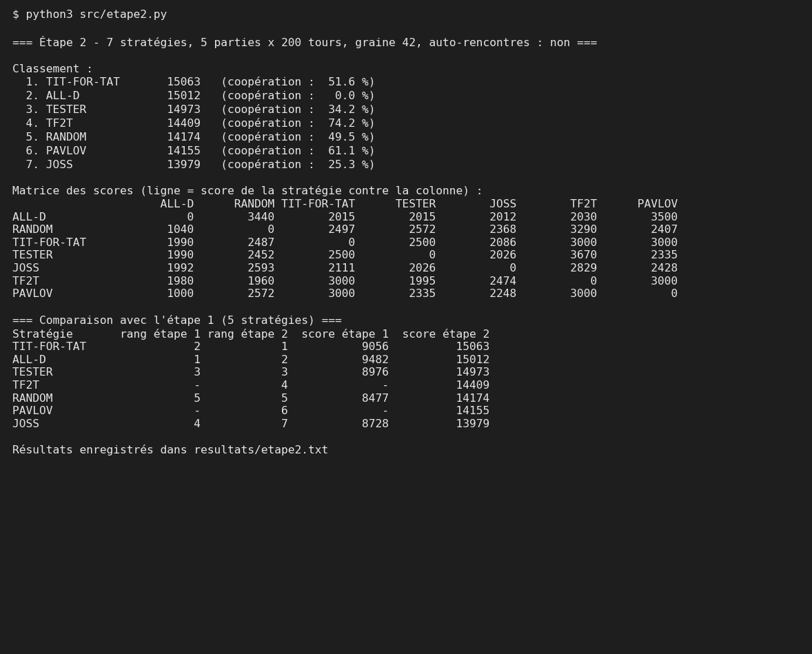
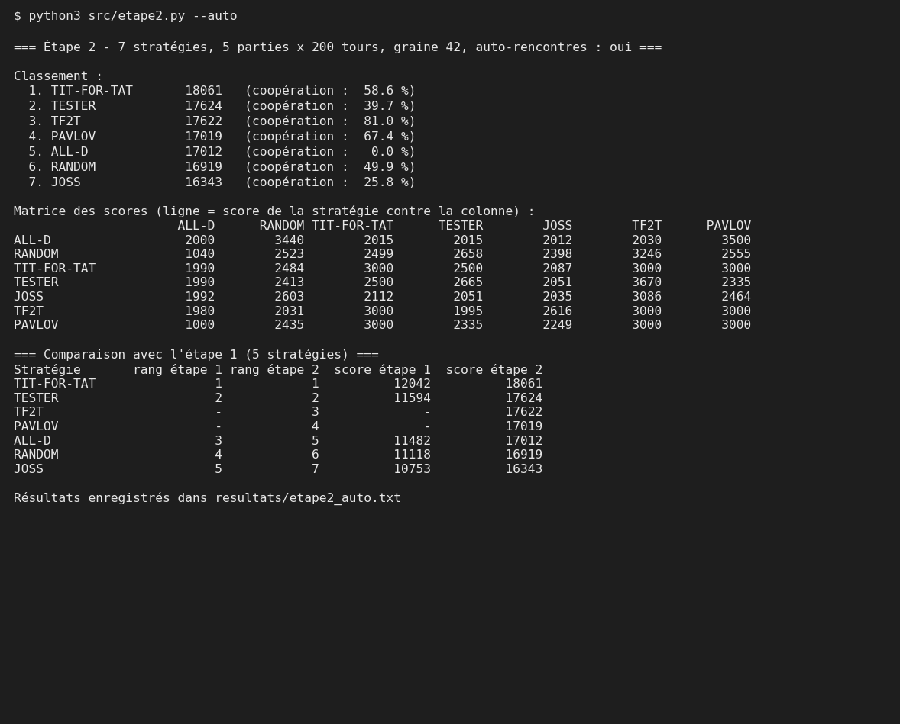
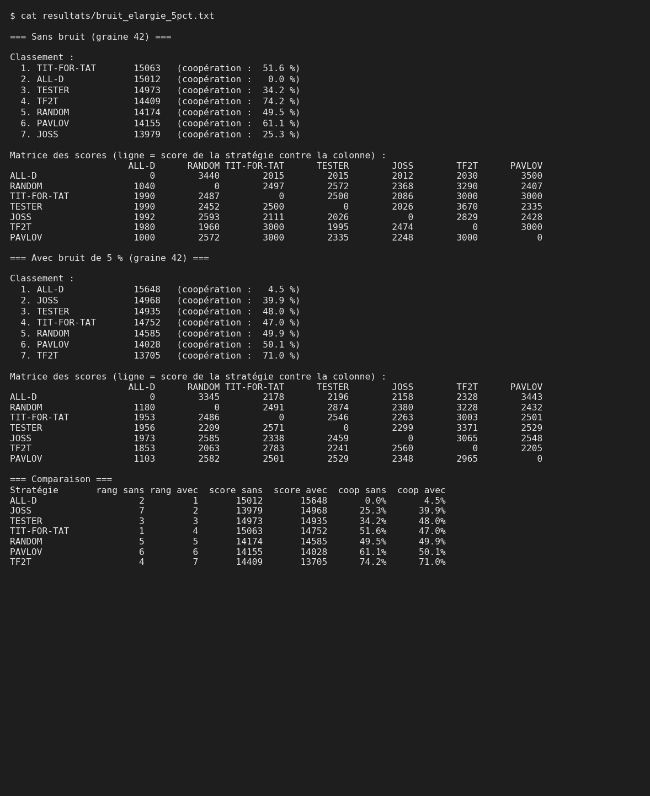
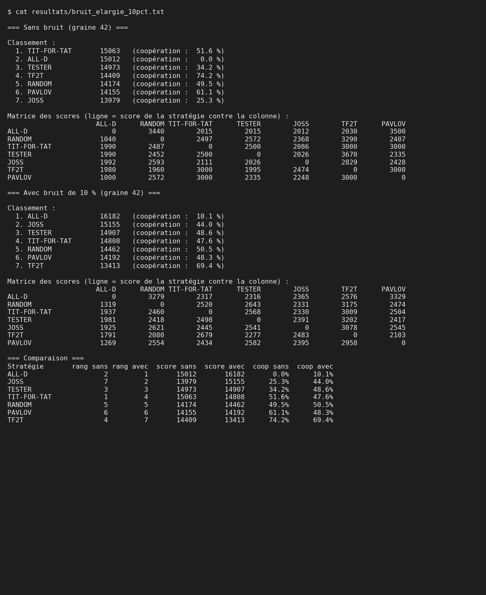
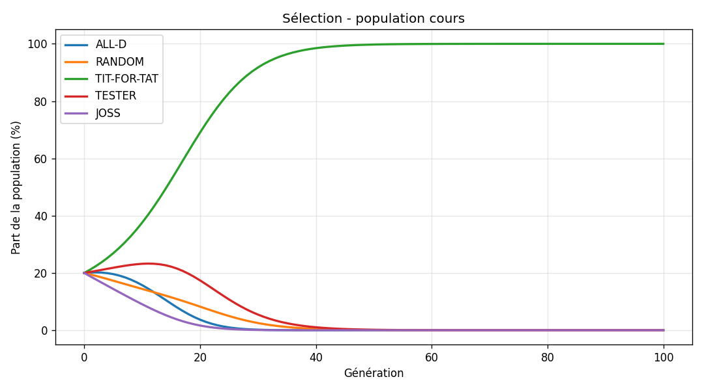
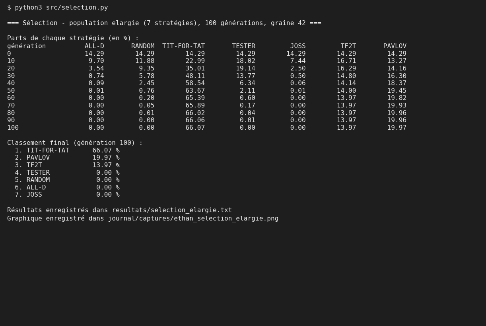
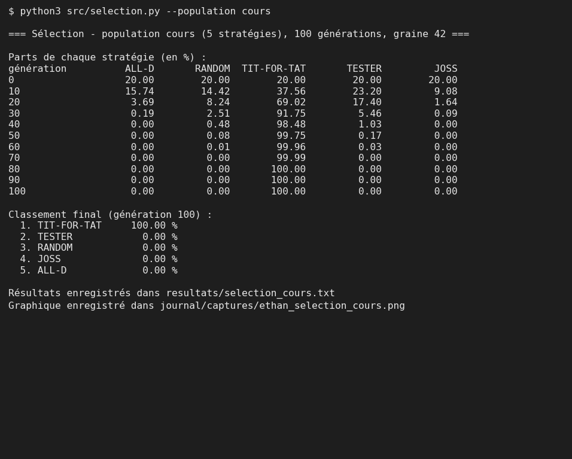

# Journal de bord – Mohamed Amine EL KAMEL et Ethan Baudrand

HAI716I – Projet 2 (partie 1) : tournoi du dilemme du prisonnier itéré, réalisé en binôme avec Ethan.

---

## 1. Protocole et choix techniques

### Paramètres du tournoi

| Paramètre                 | Valeur retenue                                                    | Raison                                                                                                                                                                         |
| ------------------------- | ----------------------------------------------------------------- | ------------------------------------------------------------------------------------------------------------------------------------------------------------------------------ |
| Parties par confrontation | 5                                                                 | format d'Axelrod imposé par le sujet                                                                                                                                           |
| Tours par partie          | 200                                                               | format d'Axelrod imposé par le sujet                                                                                                                                           |
| Gains                     | CC = 3/3, CD = 0/5, DC = 5/0, DD = 2/2                            | matrice du cours ; c'est bien un dilemme, car 5 > 3 > 2 > 0 et 2 × 3 > 5 + 0                                                                                                   |
| Graine aléatoire          | 42, un seul générateur pour tout le programme                     | les résultats doivent être relançables à l'identique (RANDOM, JOSS et le bruit utilisent tous ce générateur)                                                                   |
| Confrontations            | chaque paire joue une fois et on compte le score des deux joueurs | jouer A contre B puis B contre A compterait deux fois le même duel                                                                                                             |
| Auto-rencontres           | non par défaut, oui avec l'option `--auto`                        | le sujet dit « chaque stratégie affronte chaque **autre** » et le mini-tournoi du cours n'en contient pas, mais Axelrod les incluait en 1980 : on garde les deux pour comparer |
| Classement                | score total décroissant                                           | règle d'Axelrod                                                                                                                                                                |

### Comment représenter une stratégie

Une stratégie est une **fonction sans mémoire propre** : elle reçoit l'historique de ses coups, celui de l'adversaire et le générateur aléatoire, et renvoie `C` ou `D`.

- **Alternative écartée :** une classe avec des attributs (par exemple « l'adversaire m'a déjà trahi »).
- **Pourquoi :** avec une classe, il faut penser à remettre l'état à zéro avant chaque partie, sinon la mémoire d'une confrontation passe dans la suivante, ce qui fausse tout le tournoi. Avec une fonction, tout ce que sait la stratégie se déduit de l'historique de la partie en cours, donc ce bug est impossible.
- **Simultanéité :** les deux coups d'un tour sont calculés à partir des historiques des tours **précédents**, et chaque stratégie reçoit une copie des historiques. Aucune stratégie ne peut voir le coup actuel de l'autre ni modifier l'historique.

### Ce qu'on mesure

- **Le score total**, pour le classement.
- **La matrice des duels** (score de chaque stratégie contre chaque autre), pour comprendre **d'où** viennent les points. Elle sert aussi de base à la Sélection.
- **Le taux de coopération** de chaque stratégie. Le score seul ne dit pas si une stratégie gagne en coopérant ou en exploitant. Cette mesure s'est révélée indispensable pour comprendre le bruit.

### Vérification du moteur

Avant tout tournoi, on a vérifié le moteur sur des cas dont le résultat se calcule à la main :

| Duel (1 partie de 200 tours)      | Attendu                                | Obtenu     |
| --------------------------------- | -------------------------------------- | ---------- |
| ALL-D contre ALL-D                | 400 / 400                              | 400 / 400  |
| TFT contre TFT                    | 600 / 600                              | 600 / 600  |
| TFT contre ALL-D                  | 398 / 403 (0 + 199 × 2 et 5 + 199 × 2) | 398 / 403  |
| ALL-C contre ALL-D                | 0 / 1000                               | 0 / 1000   |
| Deux tournois avec la même graine | résultats identiques                   | identiques |

On a aussi vérifié TESTER coup par coup (voir plus bas). Ces tests garantissent que les écarts observés ensuite viennent des stratégies et non d'un bug.

---

## 2. Les cinq stratégies du cours

Les règles viennent du cours 4. Quand le cours laisse un point ouvert, on indique la convention choisie et pourquoi.

### ALL-D – toujours trahir

- **Règle :** joue D à chaque tour.
- **Rôle dans le tournoi :** c'est le cas extrême de l'égoïsme. Elle mesure jusqu'où on peut gagner sans jamais coopérer.
- **Devrait bien jouer contre :** RANDOM, qu'elle exploite chaque fois que RANDOM coopère.
- **Devrait mal jouer contre :** aucune stratégie ne la bat en duel, mais face aux stratégies qui ripostent (TFT, TESTER, JOSS), elle tombe dans D/D et ne gagne presque rien de plus que 2 points par tour.

### RANDOM – jouer au hasard

- **Règle :** C ou D avec 50 % de chances chacun.
- **Rôle :** c'est le témoin, la stratégie « sans intelligence ». Axelrod l'avait aussi ajoutée en 1980 pour la même raison.
- **Devrait mal jouer contre :** ALL-D, qui l'exploite. Elle ne peut construire aucune coopération stable.

### TIT-FOR-TAT – donnant-donnant

- **Règle :** coopère au premier tour, puis copie le dernier coup de l'adversaire.
- **Origine :** proposée par Anatol Rapoport, gagnante du tournoi d'Axelrod de 1980.
- **Rôle :** c'est la stratégie de référence du sujet. Elle est gentille (ne trahit jamais en premier), elle punit immédiatement et elle pardonne immédiatement.
- **Devrait bien jouer contre :** les stratégies qui coopèrent (3 points par tour pendant toute la partie).
- **Devrait mal jouer contre :** ALL-D (elle perd le premier tour), et les stratégies qui trahissent de temps en temps, avec lesquelles elle risque d'entrer dans des échos de représailles.

### TESTER – tester l'adversaire

- **Règle du cours :** si l'adversaire riposte, jouer TIT-FOR-TAT ; sinon répéter C, C, D.
- **Conventions choisies :** tour 1 = D ; tour 2 = C ; on considère qu'il y a « riposte » si l'adversaire joue D au tour 2, c'est-à-dire juste après notre trahison. S'il a riposté, TESTER joue TFT à partir du tour 3 ; sinon, il répète C, C, D à partir du tour 2.
- **Pourquoi :** une riposte est par définition une réponse à notre trahison, et la seule réponse directe possible est le coup du tour suivant. Juger sur un tour plus tardif confondrait riposte et trahison spontanée.
- **Alternative écartée :** faire « s'excuser » TESTER (un C de plus avant de passer en TFT), comme dans certaines versions d'Axelrod. On a gardé la lecture littérale du cours pour ne pas inventer une règle, et on a observé ses conséquences (étape 1).
- **Devrait bien jouer contre :** les stratégies qui ne punissent pas, qu'il exploite un tour sur trois.
- **Devrait mal jouer contre :** TFT, avec qui il risque l'écho.

### JOSS – TFT sournois

- **Règle du cours :** TIT-FOR-TAT, mais remplace C par D une fois sur dix.
- **Convention choisie :** les 10 % s'appliquent à chaque tour où TFT jouerait C, **y compris le premier tour**.
- **Pourquoi :** c'est la lecture littérale de la règle, et le cours ne prévoit aucune exception pour le premier tour.
- **Origine :** programme soumis par Johann Joss au tournoi de 1980.
- **Rôle :** il montre ce que coûte une petite dose de trahison dans une stratégie réciproque.
- **Devrait mal jouer contre :** TFT et toutes les stratégies réciproques, car chaque trahison surprise déclenche des représailles qui lui coûtent plus que les 5 points gagnés.

---

## 3. Étape 1 : tournoi de base

| Rang | Sans auto-rencontres | Coop.  | Avec auto-rencontres | Coop.  |
| ---- | -------------------- | ------ | -------------------- | ------ |
| 1    | ALL-D – 9482         | 0,0 %  | TIT-FOR-TAT – 12042  | 41,6 % |
| 2    | TIT-FOR-TAT – 9056   | 27,3 % | TESTER – 11594       | 35,1 % |
| 3    | TESTER – 8976        | 26,7 % | ALL-D – 11482        | 0,0 %  |
| 4    | JOSS – 8728          | 14,7 % | RANDOM – 11118       | 49,8 % |
| 5    | RANDOM – 8477        | 49,4 % | JOSS – 10753         | 12,5 % |

Matrice des duels sans auto-rencontres (score de la ligne contre la colonne, sur 5 parties) :

|            | ALL-D | RANDOM | TFT  | TESTER | JOSS |
| ---------- | ----- | ------ | ---- | ------ | ---- |
| **ALL-D**  | –     | 3440   | 2015 | 2015   | 2012 |
| **RANDOM** | 1040  | –      | 2497 | 2572   | 2368 |
| **TFT**    | 1990  | 2487   | –    | 2500   | 2079 |
| **TESTER** | 1990  | 2452   | 2500 | –      | 2034 |
| **JOSS**   | 1992  | 2593   | 2104 | 2039   | –    |

### TIT-FOR-TAT gagne-t-il ?

**Non, pas dans le format du sujet : ALL-D gagne et TFT est 2e.** TFT gagne seulement si on ajoute les auto-rencontres.

**Pourquoi ce résultat diffère de 1980 :**

1. **TFT n'a personne avec qui coopérer.** Elle gagne ses points grâce à la coopération mutuelle à 3 points par tour, soit 3000 sur 5 parties. Ici, aucun de ses adversaires ne lui permet ça : ALL-D trahit toujours, RANDOM est imprévisible, JOSS trahit par surprise et TESTER entre en écho avec elle. Son meilleur duel n'atteint que 2500.
2. **ALL-D vit de RANDOM.** Il prend 3440 points à RANDOM, contre 2487 pour TFT face à la même stratégie. Contre les trois autres, il ne perd presque rien (environ 2015 chacun, soit à peine plus que D/D toute la partie). Ces 950 points d'avance sur RANDOM suffisent à le mettre 1er.
3. **La population de 1980 était différente.** Il y avait 14 programmes, dont beaucoup de « gentils », qui ne trahissent jamais en premier. TFT coopérait pleinement avec eux. Nos cinq stratégies comptent au contraire trois stratégies qui trahissent volontairement (ALL-D, TESTER, JOSS) et une imprévisible.
4. **Axelrod comptait les auto-rencontres.** Avec `--auto`, TFT gagne 3000 contre sa copie, alors qu'ALL-D ne gagne que 2000 contre la sienne. Ces 1000 points d'écart suffisent à faire passer TFT devant ALL-D.

**Conclusion :** le succès de TFT n'est pas absolu. Il dépend de la population : TFT ne gagne que s'il y a assez de stratégies avec qui coopérer.

### L'écho entre TFT et TESTER

Le duel TFT contre TESTER donne exactement 2500 à chacun, ce qui ne peut pas être un hasard. Tour par tour :

| Tour   | 1   | 2   | 3   | 4   | 5   | …   |
| ------ | --- | --- | --- | --- | --- | --- |
| TESTER | D   | C   | D   | C   | D   | …   |
| TFT    | C   | D   | C   | D   | C   | …   |

TFT riposte au tour 2 ; TESTER passe alors en TFT et copie cette riposte ; TFT copie la copie… Les deux stratégies jouent toujours en décalé. Chacune gagne 5 puis 0, soit 2,5 points par tour en moyenne : 500 par partie et 2500 sur 5 parties.

C'est l'**écho de représailles** : deux stratégies réciproques peuvent se punir à tour de rôle indéfiniment. Il vient directement de notre lecture littérale de TESTER, qui passe en TFT sans geste de réconciliation. Ce défaut a orienté notre choix de nouvelles stratégies à l'étape 2.

---

## 4. Étape 2 : deux nouvelles stratégies

Le choix a été fait ensemble avec Ethan, qui les a programmées. Plutôt que d'ajouter des stratégies au hasard, on a voulu **répondre aux deux faiblesses observées à l'étape 1** : l'écho de représailles et la fragilité face aux erreurs.

### TIT-FOR-TWO-TATS (TF2T) – contre l'écho

- **Règle :** coopère, et ne trahit que si l'adversaire a trahi **aux deux derniers tours**.
- **Origine :** Axelrod a remarqué après coup que cette stratégie aurait gagné son premier tournoi si quelqu'un l'avait proposée.
- **Pourquoi elle :** elle ignore une trahison isolée, donc elle ne peut pas lancer d'écho. Contre JOSS ou TESTER, une trahison seule ne déclenche pas de représailles en chaîne.
- **Faiblesse attendue :** elle est exploitable. Le cycle C, C, D de TESTER ne contient jamais deux D d'affilée : TF2T ne riposte donc jamais, et TESTER prend 5 points un tour sur trois.

### PAVLOV (Win-Stay, Lose-Shift) – contre les erreurs

- **Règle :** coopère au premier tour. Ensuite, si le tour précédent lui a rapporté 3 ou 5 points (« gagné »), elle rejoue le même coup ; s'il lui a rapporté 0 ou 2 (« perdu »), elle change de coup.
- **Origine :** décrite par Kraines et Kraines (1989), puis rendue célèbre par Nowak et Sigmund (1993), qui ont montré qu'elle fait mieux que TFT dans un environnement avec erreurs.
- **Pourquoi elle :** elle sait **revenir à la coopération** après une erreur. Si deux PAVLOV coopèrent et que l'une trahit par erreur, celle qui a trahi a gagné 5 et continue de trahir, celle qui a perdu change et trahit aussi. Au tour suivant, D/D rapporte 2 aux deux, donc les deux changent et reviennent à C. La coopération revient en deux tours, alors que TFT entrerait en écho.
- **Faiblesse attendue :** contre ALL-D, elle alterne C et D (après D/D elle change pour C, prend 0, change pour D…). Elle ne gagne que 1 point par tour en moyenne, contre 2 pour TFT.

### Stratégies écartées

- **ALL-C (toujours coopérer) :** trop simple, et elle ne ferait que nourrir ALL-D.
- **GRIM TRIGGER (punir pour toujours après la première trahison) :** c'est l'inverse de ce qu'on cherche, car une seule trahison de JOSS casserait toute la partie.
- **TFT généreux :** il est mentionné dans le cours, donc il risquait de ne pas compter comme « absent du cours ».

### Prédictions

1. Contre ALL-D, sur une partie : TF2T 396 / ALL-D 406 (elle coopère deux fois avant de riposter), et PAVLOV environ 200 / ALL-D environ 700 (alternance C/D).
2. TF2T, PAVLOV et TFT coopèrent pleinement entre elles (3 points par tour), ce qui donne enfin à TFT des partenaires : son score devrait monter nettement.
3. TESTER devrait exploiter TF2T et monter au classement.
4. ALL-D devrait perdre la 1re place, car les nouvelles stratégies coopératives profitent surtout aux stratégies réciproques.

### Résultats et comparaison avec l'étape 1

Commande : `python3 src/etape2.py` (et `python3 src/etape2.py --auto`). Résultats complets dans `resultats/etape2.txt` et `resultats/etape2_auto.txt`.

**Classement à 7 stratégies, comparé à l'étape 1.** Le total n'est pas comparable d'une étape à l'autre : à l'étape 2, chaque stratégie joue 6 adversaires au lieu de 4. On ajoute donc le score moyen par adversaire (total divisé par le nombre d'adversaires).

| Stratégie   | Rang étape 1 | Rang étape 2 | Total étape 1 → 2 | Moyenne par adversaire 1 → 2 | Coop. étape 2 |
| ----------- | ------------ | ------------ | ----------------- | ---------------------------- | ------------- |
| TIT-FOR-TAT | 2            | 1            | 9056 → 15063      | 2264 → 2511                  | 51,6 %        |
| ALL-D       | 1            | 2            | 9482 → 15012      | 2371 → 2502                  | 0,0 %         |
| TESTER      | 3            | 3            | 8976 → 14973      | 2244 → 2496                  | 34,2 %        |
| TF2T        | –            | 4            | –  → 14409        | – → 2402                     | 74,2 %        |
| RANDOM      | 5            | 5            | 8477 → 14174      | 2119 → 2362                  | 49,5 %        |
| PAVLOV      | –            | 6            | –  → 14155        | – → 2359                     | 61,1 %        |
| JOSS        | 4            | 7            | 8728 → 13979      | 2182 → 2330                  | 25,3 %        |

Avec les auto-rencontres, le classement est : TIT-FOR-TAT 18061, TESTER 17624, TF2T 17622, PAVLOV 17019, ALL-D 17012, RANDOM 16919, JOSS 16343. TFT reste 1er (il l'était déjà à l'étape 1), ALL-D passe de la 3e à la 5e place.

Matrice des duels à 7 stratégies, sans auto-rencontres (score de la ligne contre la colonne, sur 5 parties) :

|            | ALL-D | RANDOM | TFT  | TESTER | JOSS | TF2T | PAVLOV |
| ---------- | ----- | ------ | ---- | ------ | ---- | ---- | ------ |
| **ALL-D**  | –     | 3440   | 2015 | 2015   | 2012 | 2030 | 3500   |
| **RANDOM** | 1040  | –      | 2497 | 2572   | 2368 | 3290 | 2407   |
| **TFT**    | 1990  | 2487   | –    | 2500   | 2086 | 3000 | 3000   |
| **TESTER** | 1990  | 2452   | 2500 | –      | 2026 | 3670 | 2335   |
| **JOSS**   | 1992  | 2593   | 2111 | 2026   | –    | 2829 | 2428   |
| **TF2T**   | 1980  | 1960   | 3000 | 1995   | 2474 | –    | 3000   |
| **PAVLOV** | 1000  | 2572   | 3000 | 2335   | 2248 | 3000 | –      |

**Réponse : TFT prend la 1re place, mais de justesse.** Il passe devant ALL-D de 51 points seulement (15063 contre 15012), et TESTER est à 90 points. Avec une seule graine, ce petit écart peut dépendre du hasard de RANDOM et de JOSS. On ne l'a pas testé avec d'autres graines. Ce qui est solide, c'est la structure de la matrice : TFT, TF2T et PAVLOV font 3000 entre eux, ce qui n'existait pas à l'étape 1.

#### Comparaison avec les prédictions

1. **Contre ALL-D : juste.** TF2T fait 1980 contre 2030 pour ALL-D, soit 396 / 406 par partie. PAVLOV fait 1000 contre 3500, soit 200 / 700 par partie. Ces valeurs sont aussi vérifiées par `verifier.py`.
2. **TF2T, PAVLOV et TFT coopèrent pleinement entre elles : juste.** Les trois duels valent 3000 / 3000 (3 points par tour pendant 1000 tours). Le score de TFT monte nettement : sa moyenne par adversaire passe de 2264 à 2511 (+11 %), et il gagne une place.
3. **TESTER exploite TF2T et monte au classement : à moitié juste.** L'exploitation est bien là : TESTER prend 3670 à TF2T, c'est son meilleur duel, alors que TF2T n'en tire que 1995 (le cycle C, C, D ne contient jamais deux D de suite, donc TF2T ne riposte jamais). Mais TESTER **ne monte pas** : il reste 3e. Sa moyenne par adversaire progresse (2244 → 2496), mais celles de TFT et d'ALL-D progressent aussi, donc il garde sa place. Notre erreur est d'avoir pensé que le gain contre TF2T suffirait : TESTER ne fait que 2335 contre PAVLOV, et 2500 contre TFT à cause de l'écho (voir plus haut).
4. **ALL-D perd la 1re place : juste, mais de peu.** Il passe 2e. Notre raisonnement était incomplet : on pensait que les nouvelles stratégies ne l'aideraient pas. Or **PAVLOV lui offre une nouvelle victime** (3500, plus que RANDOM avec 3440). Seule TF2T lui résiste (2030, car elle riposte après deux trahisons). C'est pour ça qu'ALL-D reste à 51 points de la tête.

#### Ce que le tournoi dit des deux nouvelles fiches

- **TF2T** (4e) coopère à 74,2 %, c'est la stratégie la plus coopérative. Elle **gagne** contre TFT et PAVLOV (3000 chacun) et **perd** contre ceux qui l'exploitent : TESTER (1995 contre 3670), RANDOM (3290 pour RANDOM) et, à moindre échelle, JOSS (2474 contre 2829). Elle ne tombe pas dans l'écho, mais elle laisse les trahisons gratuites : c'est la règle d'Axelrod « rendre la pareille » appliquée trop mollement.
- **PAVLOV** (6e) fait 3000 avec TFT et TF2T, mais s'effondre contre ALL-D (1000, contre 1990 pour TFT). Elle n'a pas de mémoire : après D/D, elle change pour C, prend 0, change pour D, etc. Ces 990 points perdus par rapport à TFT l'emportent sur ses bons duels. Elle fait mieux que TFT contre JOSS (2248 contre 2086), mais moins bien contre TESTER (2335 contre 2500).

#### Lien avec le cours

- **Diapo 62 :** une stratégie coopérative peut gagner au total si elle croise assez de coopérateurs. C'est ce qui arrive à TFT : coopération à 51,6 % seulement, mais 3000 contre TF2T et PAVLOV. Les deux stratégies ajoutées lui ont fourni les partenaires qui lui manquaient à l'étape 1.
- **Diapo 69 :** TFT n'est pas « la » stratégie optimale, son score dépend de la population. À l'étape 1 il est 2e, à l'étape 2 il est 1er, sans qu'on ait touché à sa règle. Mais TF2T, plus coopérative encore (74,2 %), n'est que 4e : être très gentil ne suffit pas non plus.
- **Diapo 70 (règles d'Axelrod) :** les trois stratégies gentilles (TFT, TF2T, PAVLOV) coopèrent entre elles. TFT n'est jamais envieux (il ne cherche pas à battre son adversaire dans un duel) et rend la pareille tout de suite ; TF2T attend deux trahisons, et se fait exploiter. JOSS, trop malin (il trahit sans raison), finit 7e, et TESTER ne se classe 3e que grâce à son duel contre TF2T.

---

## 5. Étape 3 – Modification 1 : le bruit

### Pourquoi cette modification

- **Le bruit teste directement la faiblesse qu'on a trouvée à l'étape 1.** L'écho TFT/TESTER montre que les stratégies réciproques sont sensibles à une trahison isolée. Le bruit en crée partout : on peut mesurer à quel point chaque stratégie y résiste.
- **C'est la modification la plus réaliste :** dans une vraie interaction, les erreurs et les malentendus existent.
- **Pourquoi pas l'horizon inconnu :** aucune de nos stratégies ne compte les tours ni ne change de comportement à l'approche du 200e. Rendre la fin incertaine ne changerait donc presque rien à leur comportement, et l'expérience serait peu informative.

### Modèle de bruit retenu

Chaque coup choisi est inversé avec une probabilité p. Le coup inversé est **réellement joué** : il compte dans les gains et c'est lui que l'adversaire voit.

- **Alternative écartée :** une erreur de perception, où seul l'adversaire voit le mauvais coup (version de la diapositive 72 du cours).
- **Pourquoi :** le sujet parle de coups « inversés ». De plus, avec notre modèle, les deux joueurs ont le même historique de la partie. Avec une erreur de perception, chacun aurait sa propre version de l'historique, ce qui demanderait de changer le moteur en profondeur.

### Premier essai à 5 % : observation exploratoire

Le premier lancement à 5 %, la valeur proposée par le sujet, a d'abord servi à tester le script, avant qu'une prédiction soit écrite. On le traite donc comme une observation exploratoire. C'est elle qui a guidé la vraie prédiction, faite ensuite pour 10 %.

| Stratégie   | Rang sans → avec | Score sans → avec | Coop. sans → avec |
| ----------- | ---------------- | ----------------- | ----------------- |
| ALL-D       | 1 → 1            | 9482 → 9877       | 0,0 % → 4,7 %     |
| TIT-FOR-TAT | 2 → 2            | 9056 → 9349       | 27,3 % → 39,1 %   |
| JOSS        | 4 → 3            | 8728 → 9310       | 14,7 % → 29,2 %   |
| TESTER      | 3 → 4            | 8976 → 9018       | 26,7 % → 39,9 %   |
| RANDOM      | 5 → 5            | 8477 → 8959       | 49,4 % → 50,0 %   |

**Surprise :** l'idée du cours est que le bruit détruit la coopération. On observe l'inverse : la coopération **monte** pour toutes les stratégies, et tous les scores aussi.

**Explication :** le bruit ne détruit que la coopération qui existe. Sans bruit, notre population n'en a presque pas : elle est bloquée soit en D/D (contre ALL-D), soit dans des échos C/D (TFT contre TESTER ou JOSS). Une erreur peut **débloquer** ces situations. Par exemple, si celui qui devait jouer D dans un écho joue C par erreur, les deux se retrouvent en C/C, et comme ils copient, ils restent en coopération jusqu'à la prochaine erreur. TFT contre JOSS passe ainsi de 2079 à 2317. Les 4,7 % de coopération d'ALL-D sont simplement ses D inversés par le bruit.

### Prédiction pour 10 % (écrite avant le lancement)

1. ALL-D coopérera environ 10 % du temps, uniquement à cause du bruit.
2. L'effet de déblocage va continuer : la coopération de TFT, TESTER et JOSS va encore monter.
3. ALL-D restera 1er, mais son avance sur le 2e va diminuer, car le bruit aide les stratégies réciproques à sortir des échos.

### Résultats à 10 %

| Stratégie   | Rang sans → avec | Score sans → avec | Coop. sans → avec |
| ----------- | ---------------- | ----------------- | ----------------- |
| ALL-D       | 1 → 1            | 9482 → 10277      | 0,0 % → 10,2 %    |
| JOSS        | 4 → 2            | 8728 → 9429       | 14,7 % → 35,5 %   |
| TESTER      | 3 → 3            | 8976 → 9278       | 26,7 % → 43,9 %   |
| TIT-FOR-TAT | 2 → 4            | 9056 → 9217       | 27,3 % → 40,0 %   |
| RANDOM      | 5 → 5            | 8477 → 8984       | 49,4 % → 50,1 %   |

### Comparaison avec la prédiction

- **Juste :** ALL-D coopère à 10,2 % et reste 1er. La coopération de TESTER et JOSS continue de monter (43,9 % et 35,5 %).
- **Faux :** l'avance d'ALL-D **augmente** au lieu de diminuer (848 points sur le 2e, contre 528 à 5 %). Surtout, **TFT s'effondre de la 2e à la 4e place**, et son score baisse par rapport à 5 % (9349 → 9217). La coopération de TFT stagne (39,1 % → 40,0 %).

### Explication de l'écart

On avait sous-estimé un effet : **TFT réagit mécaniquement à chaque erreur, dans les deux sens.**

- **Contre ALL-D :** quand ALL-D joue C par erreur, TFT le copie au tour suivant et joue C contre un D : il prend 0. Plus il y a de bruit, plus TFT se fait exploiter : TFT contre ALL-D passe de 1990 sans bruit à 1953 à 5 % et 1937 à 10 %, tandis qu'ALL-D contre TFT monte de 2015 à 2317.
- **Contre JOSS :** à 10 %, les trahisons volontaires de JOSS se noient dans le bruit. TFT punit tout autant les vraies trahisons que les erreurs. JOSS contre TFT monte à 2448 pendant que TFT contre JOSS descend à 2283.
- **Pourquoi JOSS monte à la 2e place :** ses trahisons volontaires lui coûtaient cher sans bruit, car elles déclenchaient des représailles. Avec beaucoup de bruit, tout le monde subit des trahisons, et les siennes ne se remarquent plus : elle garde le bénéfice de l'exploitation sans en payer le prix.

À 5 %, l'effet de déblocage dominait. À 10 %, c'est l'effet d'exploitation qui l'emporte. **Le bruit révèle que TFT est trop rigide :** il ne sait pas faire la différence entre une erreur et une trahison. C'est exactement le défaut que PAVLOV et TF2T sont censées corriger.

### Les nouvelles stratégies résistent-elles mieux au bruit ? (population élargie)

Une fois TF2T et PAVLOV ajoutées, `bruit.py` joue à 7 stratégies (il lit `strategies_nouvelles.py`). Les tableaux ci-dessus portent sur 5 stratégies (voir « Impasses »). On a donc relancé le bruit sur les 7 : `python3 src/bruit.py --bruit 0.05` et `--bruit 0.10`, dont la sortie est conservée dans `resultats/bruit_elargie_5pct.txt` et `resultats/bruit_elargie_10pct.txt`.

**Prédiction (annoncée plus haut, avant ce lancement) :** PAVLOV et TF2T corrigent le défaut de TFT, donc elles devraient perdre moins que lui quand le bruit augmente.

| Stratégie   | Rang sans → 5 % → 10 % | Score sans → 5 % → 10 %   | Coop. sans → 5 % → 10 %   |
| ----------- | ---------------------- | ------------------------- | ------------------------- |
| ALL-D       | 2 → 1 → 1              | 15012 → 15648 → 16182     | 0,0 % → 4,5 % → 10,1 %    |
| JOSS        | 7 → 2 → 2              | 13979 → 14968 → 15155     | 25,3 % → 39,9 % → 44,0 %  |
| TESTER      | 3 → 3 → 3              | 14973 → 14935 → 14907     | 34,2 % → 48,0 % → 48,6 %  |
| TIT-FOR-TAT | 1 → 4 → 4              | 15063 → 14752 → 14808     | 51,6 % → 47,0 % → 47,6 %  |
| RANDOM      | 5 → 5 → 5              | 14174 → 14585 → 14462     | 49,5 % → 49,9 % → 50,5 %  |
| PAVLOV      | 6 → 6 → 6              | 14155 → 14028 → 14192     | 61,1 % → 50,1 % → 48,3 %  |
| TF2T        | 4 → 7 → 7              | 14409 → 13705 → 13413     | 74,2 % → 71,0 % → 69,4 %  |

**Verdict : prédiction fausse pour le classement, partiellement juste pour PAVLOV.**

- **PAVLOV perd moins de points que TFT** (−127 à 5 %, +37 à 10 %, contre −311 et −255 pour TFT). Elle est donc stable face au bruit. Mais elle reste 6e, et TFT, même après sa chute, garde 616 points d'avance sur elle à 10 % (14808 contre 14192).
- **TF2T résiste moins bien que TFT** : elle perd 704 puis 996 points, et finit dernière. Sa coopération baisse peu (74,2 % → 69,4 %), mais elle se fait exploiter.

**Explication d'après la matrice des duels à 10 % :**

- PAVLOV part trop bas : contre ALL-D elle fait 1269 (TFT : 1937), et le bruit ne change pas ça (1000 sans bruit). Contre TFT elle ne fait que 2434 au lieu de 3000.
- Le « retour à la coopération en deux tours » décrit pour PAVLOV vaut quand deux PAVLOV se rencontrent. Sans auto-rencontres, elle n'en croise jamais dans ce tournoi. On n'a pas mesuré cet effet ici, c'est une hypothèse.
- TF2T tombe de 3000 à 2103 contre PAVLOV, qui en tire 2958. On pense que PAVLOV exploite son indulgence après une erreur : celle qui vient de trahir en gagnant 5 « reste » en D, alors que TF2T attend deux trahisons avant de réagir. On n'a pas vérifié coup par coup, c'est aussi une hypothèse.
- JOSS monte à la 2e place pour la raison donnée plus haut : avec du bruit, ses trahisons volontaires se perdent dans les erreurs.

**Lien avec le cours (diapo 72) :** le bruit est le cadre où Nowak et Sigmund défendent le TFT généreux, qui pardonne au hasard une partie des trahisons. Les deux stratégies qu'on a choisies sont censées corriger le problème dans leur cas type (TF2T contre l'écho, PAVLOV contre sa copie), mais cela ne se voit pas dans une population avec ALL-D, RANDOM et JOSS. Le TFT généreux, qu'on avait écarté parce qu'il figure au cours, serait le candidat naturel pour une suite. On ne l'a pas testé.

---

## 6. Étape 3 – Modification 2 : la sélection

Le choix a été fait ensemble avec Ethan, qui l'a programmée.

### Pourquoi cette modification

Le classement de l'étape 1 est une photo : il dit qui gagne le plus de points **une fois**. Il ne dit pas si cette victoire peut **durer**. ALL-D gagne surtout grâce à RANDOM. Si les stratégies qui gagnent se multiplient et que les autres disparaissent, ALL-D risque de perdre ses victimes. La sélection permet de tester ça, comme dans le tournoi « écologique » d'Axelrod.

### Modèle retenu

- On part d'une population où chaque stratégie a la même part.
- À chaque génération, le score d'une stratégie est la moyenne de ses scores contre chaque stratégie, pondérée par la part de cette stratégie dans la population. Les scores viennent de la matrice des duels.
- La nouvelle part d'une stratégie = son ancienne part × son score / le score moyen de la population. Les stratégies au-dessus de la moyenne grandissent, les autres diminuent.
- **On utilise la matrice avec auto-rencontres :** dans une population, les membres d'une même stratégie se rencontrent entre eux. Sans le score d'une stratégie contre elle-même, ce cas ne serait pas compté.

### Prédiction

1. Au début, ALL-D grandit, car il est le meilleur contre RANDOM, qui représente encore une grosse part de la population.
2. RANDOM disparaît vite, car c'est la stratégie la plus faible.
3. Une fois RANDOM disparu, ALL-D n'a plus personne à exploiter : il rencontre surtout des stratégies qui ripostent et lui-même (2 points par tour). Il décline.
4. À la fin, ce sont les stratégies réciproques (TFT, TESTER et les nouvelles) qui dominent.

### Résultats et comparaison avec la prédiction

Commandes : `python3 src/selection.py` (population élargie, 7 stratégies) et `python3 src/selection.py --population cours` (les 5 stratégies du cours), 100 générations chacune. Résultats complets dans `resultats/selection_elargie.txt` et `resultats/selection_cours.txt`. Les scores de départ viennent des matrices avec auto-rencontres (`resultats/etape2_auto.txt` et `resultats/etape1_auto.txt`).

**Population élargie (parts en %) :**

| Génération | ALL-D | RANDOM | TFT   | TESTER | JOSS  | TF2T  | PAVLOV |
| ---------- | ----- | ------ | ----- | ------ | ----- | ----- | ------ |
| 0          | 14,29 | 14,29  | 14,29 | 14,29  | 14,29 | 14,29 | 14,29  |
| 10         | 9,70  | 11,88  | 22,99 | 18,02  | 7,44  | 16,71 | 13,27  |
| 20         | 3,54  | 9,35   | 35,01 | 19,14  | 2,50  | 16,29 | 14,16  |
| 30         | 0,74  | 5,78   | 48,11 | 13,77  | 0,50  | 14,80 | 16,30  |
| 50         | 0,01  | 0,76   | 63,67 | 2,11   | 0,01  | 14,00 | 19,45  |
| 100        | 0,00  | 0,00   | 66,07 | 0,00   | 0,00  | 13,97 | 19,97  |

**Population du cours (parts en %) :**

| Génération | ALL-D | RANDOM | TFT    | TESTER | JOSS  |
| ---------- | ----- | ------ | ------ | ------ | ----- |
| 0          | 20,00 | 20,00  | 20,00  | 20,00  | 20,00 |
| 10         | 15,74 | 14,42  | 37,56  | 23,20  | 9,08  |
| 20         | 3,69  | 8,24   | 69,02  | 17,40  | 1,64  |
| 30         | 0,19  | 2,51   | 91,75  | 5,46   | 0,09  |
| 50         | 0,00  | 0,08   | 99,75  | 0,17   | 0,00  |
| 100        | 0,00  | 0,00   | 100,00 | 0,00   | 0,00  |

**Réponse à la question de départ : la victoire d'ALL-D ne dure pas.** Dans la population du cours, ALL-D passe de 20 % à 0,19 % en 30 générations, et TFT finit à 100 %. Dans la population élargie, ALL-D est à 0,74 % à la génération 30. Le classement de l'étape 1 ne dit rien sur la durée : ALL-D gagnait des points sans que ça lui assure l'avenir.

#### Comparaison avec la prédiction

1. **« ALL-D grandit au début » : faux pour la population élargie, à peine vrai pour celle du cours.** Dans la population élargie, ALL-D baisse dès la première génération : son score moyen avec auto-rencontres est de 2430, sous la moyenne de la population (2461). Dans celle du cours, il est de 2296 contre 2280 de moyenne : il monte un tout petit peu (pic de 20,19 % à la génération 2, calculé directement avec la fonction d'évolution), puis s'effondre. *Explication :* on avait raisonné avec la seule victime RANDOM (3440). Mais avec les auto-rencontres, ALL-D ne fait que 2000 contre lui-même (D/D), et 2015 environ contre TFT et TESTER. Un seul bon duel sur cinq (ou sept) ne suffit pas à passer au-dessus de la moyenne.
2. **« RANDOM disparaît vite, c'est le plus faible » : faux sur l'ordre, juste sur la fin.** RANDOM disparaît (0,05 % à la génération 70 en population élargie), mais plus tard qu'ALL-D et JOSS : à la génération 30, RANDOM est encore à 5,78 % contre 0,74 % et 0,50 %. JOSS est le plus faible au départ (2335 en population élargie, 2151 dans celle du cours, contre 2417 et 2224 pour RANDOM). *Explication :* RANDOM se fait écraser par ALL-D (1040), mais JOSS gagne bien moins que lui contre les stratégies qui coopèrent : 2829 contre TF2T (RANDOM : 3290), 2111 contre TFT (2497), 2026 contre TESTER (2572). Les trahisons de JOSS déclenchent des échos qui lui coûtent plus que les 5 points gagnés.
3. **« Une fois RANDOM disparu, ALL-D décline » : l'issue est juste, le mécanisme est faux.** ALL-D est quasi éteint (0,74 % à la génération 30) alors que RANDOM compte encore 5,78 %. ALL-D n'a donc pas eu besoin que RANDOM disparaisse : il perdait déjà face à la moyenne dès le début.
4. **« À la fin, les stratégies réciproques dominent (TFT, TESTER et les nouvelles) » : à moitié juste.** TFT domine (66,07 % en population élargie, 100 % dans celle du cours), avec PAVLOV (19,97 %) et TF2T (13,97 %). **TESTER disparaît** (0,00 % à la génération 100), alors qu'il montait à 19 % vers la génération 20 (23 % vers la génération 11 dans la population du cours). *Explication :* TESTER profite d'abord de TF2T (3670). Quand ALL-D, RANDOM et JOSS ont disparu, il ne reste que TFT, PAVLOV et TF2T. À la génération 60 (TFT 65,39 %, PAVLOV 19,82 %, TF2T 13,97 %), son score est de 0,6539 × 2500 + 0,1982 × 2335 + 0,1397 × 3670, soit environ 2610, alors que les trois autres font 3000 entre elles. Il est donc sous la moyenne et décline. Son écho avec TFT (2500) et son duel moyen contre PAVLOV (2335) lui coûtent plus que ce qu'il prend à TF2T (3670).

#### Ce qu'on retient de la sélection

- **Trois stratégies survivent ensemble en population élargie, et les parts finales (66 / 20 / 14) sont figées.** TFT, PAVLOV et TF2T font 3000 entre elles : leurs scores sont égaux, donc leurs parts ne bougent plus. Le rapport 66 / 20 / 14 vient du chemin parcouru pendant que les autres disparaissaient, pas d'une supériorité de TFT à la fin. Par exemple, TFT a pris l'avantage au début contre ALL-D (1990, contre 1000 pour PAVLOV et 1980 pour TF2T) et contre TESTER (2500, contre 2335 pour PAVLOV).
- **PAVLOV décroît d'abord (13,27 % à la génération 10), puis monte jusqu'à 19,97 %** quand ALL-D, son prédateur (3500), disparaît. TF2T monte au début (score de départ de 2517, au-dessus de la moyenne de 2461), puis redescend vers 13,97 % : tant que TESTER est nombreux (19 % vers la génération 20), il lui prend beaucoup de points (3670 contre 1995). Sa part se fige quand TESTER disparaît.
- **Lien avec le cours :** c'est le tournoi « écologique » d'Axelrod. La diapo 62 le dit : une stratégie coopérative gagne au total si elle croise assez de coopérateurs ; la sélection fabrique cette situation en éliminant les exploiteurs. La diapo 69 aussi : TFT n'est pas optimal en soi, il gagne ici parce que la population s'est remplie de partenaires qui coopèrent avec lui. Les règles d'Axelrod (diapo 70) se vérifient : les stratégies gentilles qui rendent la pareille survivent (TFT, PAVLOV, TF2T), les trop malignes (TESTER, JOSS) et celle qui trahit toujours (ALL-D) disparaissent.
- **Limite :** le modèle n'a pas de mutation. Une stratégie à 0,00 % ne revient jamais, et on n'a testé qu'une graine pour la matrice de départ.

---

## 7. Impasses et corrections

- **Écho TFT/TESTER :** notre lecture littérale de TESTER crée un écho permanent avec TFT. On a choisi de ne pas « corriger » la règle du cours, mais d'en analyser l'effet et d'y répondre à l'étape 2 avec TF2T.
- **Premier tour de JOSS :** le cours ne dit pas si les 10 % s'appliquent au premier tour. On a appliqué la règle telle qu'elle est écrite.
- **Prédiction du bruit :** le premier lancement à 5 % a été fait avant d'écrire une prédiction. Pour respecter la démarche demandée, on l'a traité comme une observation exploratoire, et on a fait une vraie prédiction pour 10 % avant de lancer ce tournoi.
- **Erreur d'import (`ImportError`) :** `bruit.py` utilise aussi les stratégies d'Ethan. Tant que son fichier était vide, le script plantait. On a placé un dictionnaire vide dans `strategies_nouvelles.py`, pour que chaque partie du projet fonctionne sans attendre l'autre.
- **Limite du générateur unique :** tous les tirages viennent du même générateur. Ajouter une stratégie change l'ordre des tirages, donc les duels impliquant RANDOM ou JOSS donnent des scores légèrement différents d'un tournoi à l'autre (par exemple, TFT contre RANDOM vaut 2487 sans auto-rencontres et 2484 avec). Les comparaisons restent valables, car les écarts dus au hasard sont faibles devant ceux qu'on analyse, mais il faut le garder en tête.
- **Incohérence de reproductibilité du bruit (trouvée à l'assemblage) :** `bruit.py` importe `STRATEGIES_NOUVELLES`. Une fois TF2T et PAVLOV ajoutées, `python3 src/bruit.py` donne 7 stratégies, alors que les tableaux de la section 5 portent sur 5. Les chiffres d'Amine restent exacts : en appelant `tournoi()` avec les 5 stratégies du cours et le bruit à 5 % et 10 %, on retrouve ses scores (9877 et 10277 pour ALL-D, par exemple). Mais relancer `python3 src/bruit.py` ne les redonne plus, et elle écrase `resultats/bruit_5pct.txt` par un tableau à 7 stratégies (on l'a restauré avec `git checkout`). De plus, `resultats/bruit_10pct.txt`, d'où vient le tableau à 10 %, n'est pas dans le dépôt. Pour la sous-section sur les 7 stratégies, on a gardé la sortie dans des fichiers à part (`resultats/bruit_elargie_*.txt`). Une vraie correction demanderait une option `--population` dans `bruit.py`.
- **Captures manquantes :** le journal d'Amine renvoie vers `captures/mohamed_*.png`, mais le dossier `journal/captures/` ne contenait que `.gitkeep` avant nos images. Ces images sont à produire par lui.
- **README vide :** il ne contient aucune commande de relance. Les commandes pour l'étape 2 et la sélection sont à y ajouter.
- **Comparaison des totaux entre étapes :** à l'étape 2, les totaux (15063 pour TFT) ne se comparent pas à ceux de l'étape 1 (9056), puisqu'il y a plus d'adversaires. On a ajouté le score moyen par adversaire.
- **matplotlib absent :** il n'était pas installé. On l'a installé avec `pip3 install --user matplotlib`, et `selection.py` fonctionne quand même sans lui (message, pas de graphique).
- **Prédictions fausses ou incomplètes :** TESTER ne monte pas (étape 2), ALL-D ne grandit pas en population élargie et ne disparaît pas parce que RANDOM disparaît (sélection). On a gardé les prédictions telles qu'écrites et expliqué l'écart au lieu de les corriger après coup.

---

## 8. Conclusion

- **TFT ne gagne pas « par nature » :** dans notre tournoi de base, ALL-D gagne, car la population ne contient pas assez de stratégies coopératives. TFT ne gagne qu'avec les auto-rencontres, comme en 1980.
- **La réciprocité stricte a deux défauts :** l'écho de représailles (TFT contre TESTER) et l'incapacité à distinguer une erreur d'une trahison (TFT avec du bruit à 10 %).
- **Le bruit a un double effet, qu'on n'avait pas prévu :** à faible dose, il débloque des situations figées et augmente la coopération ; à plus forte dose, il permet aux stratégies opportunistes d'exploiter les stratégies rigides.
- Ces observations justifient nos deux nouvelles stratégies (TF2T contre l'écho, PAVLOV contre les erreurs), et l'étape de sélection permet de tester si la victoire d'ALL-D peut durer.

- **Étape 2 :** avec TF2T et PAVLOV, TFT passe 1er (15063 contre 15012 pour ALL-D), de justesse. Il a enfin des partenaires (3000 avec chacune des deux). Mais ALL-D profite aussi de PAVLOV (3500) et reste à 51 points. Les deux nouvelles stratégies ne sont ni l'une ni l'autre gagnantes : TF2T finit 4e, PAVLOV 6e.
- **Étape 3, sélection :** la victoire d'ALL-D à l'étape 1 ne dure pas. Il est sous 1 % à la génération 30, et TFT finit à 100 % dans la population du cours, à 66 % en population élargie (avec PAVLOV 20 % et TF2T 14 %). TESTER, qui montait au début, disparaît.
- **Étape 3, bruit sur la population élargie :** PAVLOV et TF2T ne corrigent pas le défaut de TFT dans ce tournoi. PAVLOV perd moins de points que TFT mais reste 6e, TF2T finit dernière.
- **Le bon score dépend du contexte :** la 1re place de TFT change entre l'étape 1, l'étape 2, les auto-rencontres, le bruit et la sélection. Aucune stratégie n'est la meilleure partout, ce qui rejoint la diapo 69 du cours.
- **Limites :** une seule graine pour tous les tournois, un modèle de sélection sans mutation, et quelques hypothèses non mesurées (PAVLOV contre sa copie avec du bruit, PAVLOV qui exploite TF2T).
