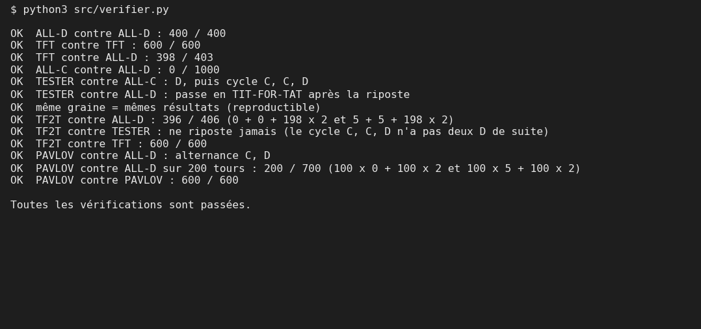
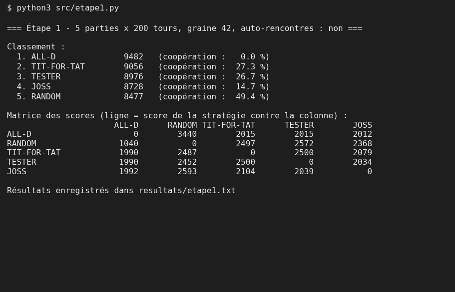
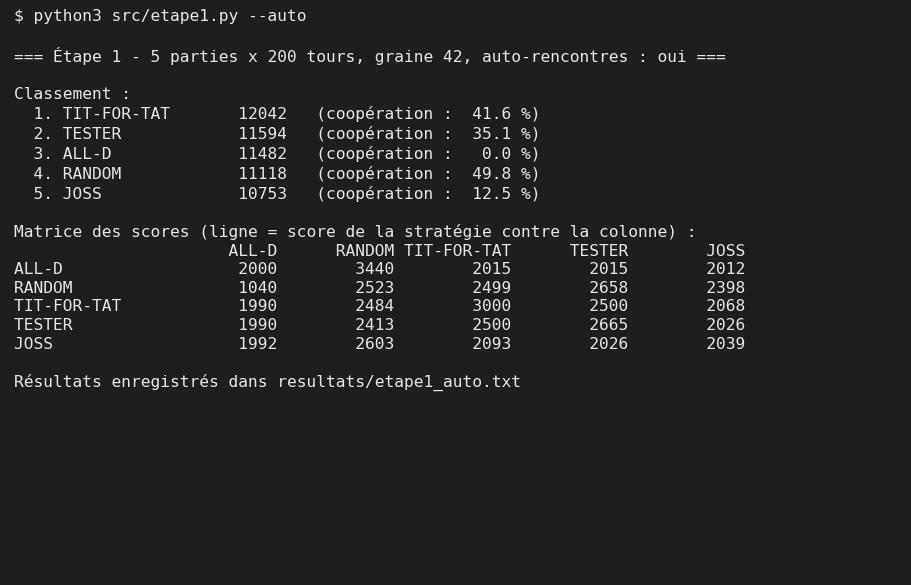
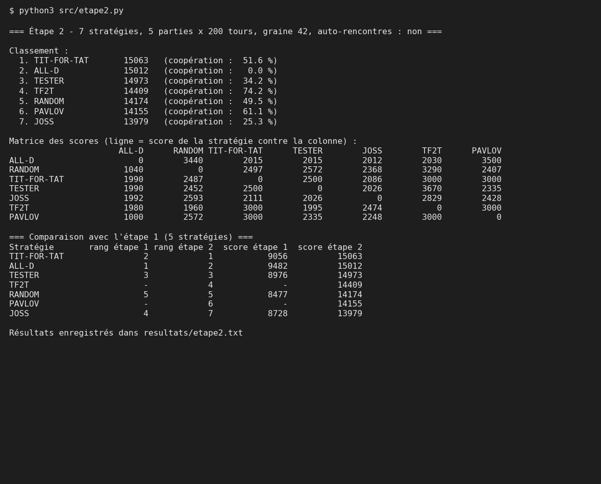
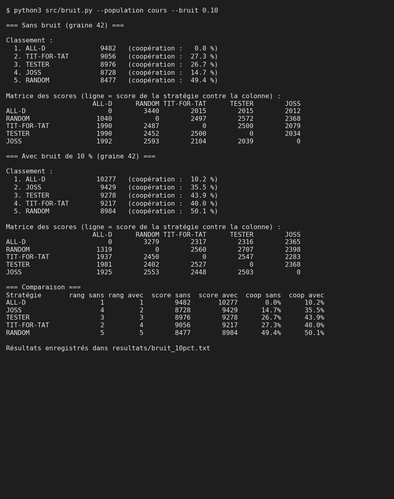

# Journal de bord – Ethan Baudrand

HAI716I, projet 2 partie 1 : tournoi du dilemme du prisonnier itéré, en binôme avec Mohamed Amine EL KAMEL. Amine a codé le moteur, les cinq stratégies du cours, l'étape 1 et le bruit. J'ai codé TF2T, PAVLOV, l'étape 2 et la sélection. Ce journal couvre tout le projet.

Le README donne la commande de chaque tournoi. Toutes les sorties sont dans `resultats/`.

## En bref

- **Étape 1 :** TFT ne gagne pas, ALL-D est 1er. TFT n'a personne avec qui coopérer ; dès qu'on compte les auto-rencontres, elle repasse 1re.
- **Étape 2 :** avec TF2T et PAVLOV, TFT trouve des partenaires et redevient 1re, de justesse. Aucune des deux nouvelles ne gagne.
- **Bruit :** un peu de bruit aide la coopération, trop de bruit fait chuter TFT. PAVLOV y résiste, TF2T s'effondre.
- **Sélection :** ALL-D disparaît en 30 générations, et il ne reste que TFT, PAVLOV et TF2T.
- **Le fil rouge :** TFT ne gagne que si la population lui offre des coopérateurs, et elle ne sait pas sortir seule d'un cycle de punitions.

---

## 1. Le tournoi

**Les règles.** Chaque paire de stratégies joue 5 parties de 200 tours, comme chez Axelrod. Les gains sont ceux du cours : 3 chacun si les deux coopèrent, 2 chacun si les deux trahissent, 5 pour celui qui trahit un coopérateur et 0 pour ce dernier. C'est bien un dilemme : trahir rapporte toujours plus (5 > 3 et 2 > 0), mais deux coopérateurs gagnent plus que deux traîtres. Le classement se fait au score total.

**Les choix qu'on a dû faire :**

- **Une seule confrontation par paire**, en comptant les scores des deux joueurs. Jouer A contre B puis B contre A compterait deux fois le même duel.
- **Les auto-rencontres en option (`--auto`).** Le sujet dit que chaque stratégie affronte chaque _autre_, mais Axelrod faisait aussi jouer chaque stratégie contre sa copie. On lance les deux versions, et la différence compte à l'étape 1.
- **Une graine fixe (42) et un seul générateur aléatoire**, pour que tout se relance à l'identique.
- **Une stratégie est une fonction sans mémoire.** À chaque tour, elle reçoit les deux historiques et renvoie C ou D. Elle ne garde rien d'un appel à l'autre, donc une partie ne peut pas déborder sur la suivante. Les deux coups d'un tour sont calculés sur les tours précédents uniquement : personne ne voit le coup de l'autre avant de jouer.

**Ce qu'on mesure :** le score total pour le classement, la matrice des duels pour savoir d'où viennent les points, et le taux de coopération pour savoir si une stratégie gagne en coopérant ou en exploitant.

**Vérification.** Avant tout tournoi, `python3 src/verifier.py` teste des duels calculés à la main :

- moteur : ALL-D contre ALL-D 400 / 400, TFT contre TFT 600 / 600, TFT contre ALL-D 398 / 403, ALL-C contre ALL-D 0 / 1000, et la même graine redonne les mêmes résultats ;
- mes stratégies : TF2T contre ALL-D 396 / 406, PAVLOV contre ALL-D 200 / 700, PAVLOV contre PAVLOV 600 / 600, et TF2T ne riposte jamais contre TESTER.

---

## 2. Les sept stratégies

### Les cinq du cours

| Stratégie   | Règle                                                                     | Origine                                                              | Bien contre                                               | Mal contre                                                                                                     |
| ----------- | ------------------------------------------------------------------------- | -------------------------------------------------------------------- | --------------------------------------------------------- | -------------------------------------------------------------------------------------------------------------- |
| ALL-D       | trahit toujours                                                           | cours (diapo 64) ; le choix « rationnel » de la récurrence à rebours | RANDOM, qu'il exploite chaque fois qu'il coopère          | celles qui ripostent : il tombe en D/D, à 2 points par tour                                                    |
| RANDOM      | C ou D avec une chance sur deux                                           | le témoin ajouté par Axelrod en 1980                                 | personne en particulier                                   | ALL-D ; il ne construit aucune coopération stable                                                              |
| TIT-FOR-TAT | C au tour 1, puis copie le dernier coup de l'adversaire                   | Anatol Rapoport, vainqueur en 1980                                   | les coopératrices, à 3 points par tour                    | ALL-D, car elle perd le tour 1, et celles qui trahissent par moments, avec qui elle entre en écho              |
| TESTER      | trahit au tour 1 ; joue TFT si l'adversaire riposte, sinon répète C, C, D | décrite par Axelrod (diapo 64)                                       | celles qui ne punissent pas, exploitées un tour sur trois | TFT, avec qui il entre en écho                                                                                 |
| JOSS        | TFT, mais remplace C par D une fois sur dix                               | Johann Joss, tournoi de 1980                                         | RANDOM                                                    | les réciproques : chaque trahison surprise déclenche des représailles qui coûtent plus que les 5 points gagnés |

### Mes deux stratégies : TF2T et PAVLOV

Je les ai choisies après l'étape 1, pour corriger le défaut de TFT qu'elle a révélé : seule, TFT ne sait pas sortir d'un cycle de punitions, que ce cycle vienne d'une trahison volontaire (l'écho avec TESTER) ou d'une erreur. Il y a deux façons d'y remédier : pardonner avant de punir, ou réparer après.

**TIT-FOR-TWO-TATS (TF2T) pardonne avant de punir.** Elle coopère, et ne trahit que si l'adversaire a trahi aux deux derniers tours.
_Origine :_ Axelrod a montré après coup qu'elle aurait gagné son premier tournoi si quelqu'un l'avait proposée.
_Bien :_ contre les réciproques. Une trahison isolée ne déclenche rien, donc l'écho ne démarre jamais.
_Mal :_ contre TESTER, dont le cycle C, C, D n'a jamais deux D de suite. TF2T ne riposte donc jamais et se fait exploiter.

**PAVLOV répare après avoir puni** (« gagné, je garde ; perdu, je change »). Elle coopère au tour 1. Ensuite, elle rejoue son coup s'il lui a rapporté 3 ou 5, et en change s'il lui a rapporté 0 ou 2. Comme elle n'a pas de mémoire, elle recalcule ce gain à partir des deux derniers coups.
_Origine :_ Kraines et Kraines (1989), puis Nowak et Sigmund (1993), les auteurs du TFT généreux de la diapo 72, l'ont rendue célèbre.
_Bien :_ contre sa copie après une erreur. Celle qui a trahi par erreur a gagné 5 et continue ; l'autre a gagné 0 et trahit aussi. Le D/D suivant rapporte 2 aux deux, qui changent ensemble et recoopèrent. La coopération revient en deux tours.
_Mal :_ contre ALL-D. Elle alterne C et D et ne marque qu'un point par tour en moyenne, contre deux pour TFT.

_Écartées :_ ALL-C, qui ne ferait que nourrir ALL-D ; GRIM TRIGGER, qu'une seule trahison de JOSS bloquerait en D pour toute la partie ; le TFT généreux, déjà dans le cours.

---

## 3. Étape 1 : TFT gagne-t-elle ?

Commandes : `python3 src/etape1.py` et `python3 src/etape1.py --auto`. Sorties dans `resultats/etape1.txt` et `resultats/etape1_auto.txt`.

| Rang | Sans auto-rencontres | Avec auto-rencontres |
| ---- | -------------------- | -------------------- |
| 1    | ALL-D 9482           | TFT 12042            |
| 2    | TFT 9056             | TESTER 11594         |
| 3    | TESTER 8976          | ALL-D 11482          |
| 4    | JOSS 8728            | RANDOM 11118         |
| 5    | RANDOM 8477          | JOSS 10753           |

**Non : ALL-D est 1er, TFT 2e.** TFT ne passe en tête qu'avec les auto-rencontres. La matrice des duels montre pourquoi :

- **ALL-D gagne grâce à RANDOM.** Il lui prend 3440 points, contre 2487 pour TFT. Contre TFT, TESTER et JOSS, il fait à peu près jeu égal (environ 2015 chacun). Ces 950 points d'avance sur RANDOM suffisent à le mettre 1er.
- **TFT n'a aucun partenaire.** Ses points viennent de la coopération, qui peut rapporter 3000 par duel, mais aucun adversaire ne coopère durablement avec elle : son meilleur duel vaut 2500.
- **Avec les auto-rencontres, TFT en trouve un : sa copie.** Elle marque 3000 contre elle-même, alors qu'ALL-D ne marque que 2000 contre la sienne. TFT repasse devant.

En 1980, Axelrod avait 14 programmes, dont beaucoup ne trahissaient jamais en premier, et il comptait les auto-rencontres. Ici, trois stratégies sur cinq trahissent volontairement. C'est ce que dit la diapo 69 : TFT n'est bonne que si la population lui offre des coopérateurs.

**Le défaut trouvé : l'écho entre TFT et TESTER.** Ce duel donne exactement 2500 à chacun.

| Tour   | 1   | 2   | 3   | 4   | 5   | …   |
| ------ | --- | --- | --- | --- | --- | --- |
| TESTER | D   | C   | D   | C   | D   | …   |
| TFT    | C   | D   | C   | D   | C   | …   |

TESTER sonde au tour 1 et TFT riposte au tour 2. TESTER passe alors en TFT et copie la riposte, que TFT copie à son tour. Les deux se punissent en décalé jusqu'au bout et marquent 5 puis 0, soit 2,5 points par tour au lieu de 3. C'est ce défaut qui m'a fait choisir TF2T et PAVLOV.

---

## 4. Étape 2 : peut-on corriger TFT ?

Commande : `python3 src/etape2.py`. Sortie dans `resultats/etape2.txt`. Les fiches de TF2T et PAVLOV sont dans la section 2.

Chaque stratégie a maintenant 6 adversaires au lieu de 4. Je compare donc la moyenne par adversaire, pas le total.

| Stratégie   | Rang étape 1 → 2 | Moyenne par adversaire 1 → 2 |
| ----------- | ---------------- | ---------------------------- |
| TIT-FOR-TAT | 2 → 1            | 2264 → 2511                  |
| ALL-D       | 1 → 2            | 2371 → 2502                  |
| TESTER      | 3 → 3            | 2244 → 2496                  |
| TF2T        | – → 4            | – → 2402                     |
| RANDOM      | 5 → 5            | 2119 → 2362                  |
| PAVLOV      | – → 6            | – → 2359                     |
| JOSS        | 4 → 7            | 2182 → 2330                  |

**Prédictions et résultats :**

1. _TF2T fera 396 / 406 contre ALL-D, et PAVLOV environ 200 / 700._ **Juste.**
2. _TFT, TF2T et PAVLOV coopéreront entre elles, et le score de TFT montera._ **Juste :** ces trois duels valent 3000.
3. _TESTER exploitera TF2T et montera au classement._ **À moitié juste.** Il lui prend bien 3670 points, son meilleur duel, mais il reste 3e. Il est freiné par l'écho contre TFT (2500) et par son duel contre PAVLOV (2335).
4. _ALL-D perdra la 1re place._ **Juste, mais de peu.** Je n'avais pas prévu que PAVLOV lui offrirait une nouvelle victime : ALL-D lui prend 3500 points, plus qu'à RANDOM.

**Bilan.** TFT repasse 1re, avec 51 points d'avance seulement, et sur une seule graine. Un résultat est solide : TFT, TF2T et PAVLOV marquent 3000 entre elles, ce qui donne enfin à TFT les partenaires qui lui manquaient (diapo 62). Mes deux corrections, elles, ne gagnent pas. TF2T, 4e, se laisse exploiter par TESTER et RANDOM. PAVLOV, 6e, s'effondre contre ALL-D (1000 points, contre 1990 pour TFT). Être plus gentil que TFT ne suffit donc pas.

---

## 5. Étape 3 : deux modifications

J'ai retenu le bruit, parce qu'il attaque directement le défaut trouvé à l'étape 1, et la sélection, parce qu'elle dit si un classement peut durer. J'ai écarté l'horizon inconnu, car aucune de nos stratégies ne compte les tours, donc rien ne changerait, et les autres gains, pour que les étapes restent comparables.

### Le bruit : et si les joueurs se trompent ?

**Le modèle.** Chaque coup est inversé avec une probabilité p, et le coup inversé est vraiment joué : il compte dans les gains et l'adversaire le voit. On n'a pas fait l'erreur de perception de la diapo 72, où chaque joueur aurait sa propre version de l'historique : il aurait fallu refaire le moteur.

**Sur les 5 stratégies du cours.** Commandes : `python3 src/bruit.py --population cours --bruit 0.05`, puis `--bruit 0.10`. Sorties dans `resultats/bruit_5pct.txt` et `resultats/bruit_10pct.txt`.

_5 % : un premier essai sans prédiction._ Ce lancement servait à tester le script, donc je le traite comme une simple observation. Il nous a surpris : la coopération et les scores montent pour tout le monde. Le bruit ne peut casser que la coopération qui existe, or notre population est surtout bloquée en D/D ou en écho. Une erreur peut débloquer un écho : si celui qui devait trahir coopère par erreur, les deux se retrouvent en C/C et y restent jusqu'à l'erreur suivante. TFT contre JOSS passe ainsi de 2079 à 2317.

_Prédiction pour 10 %, écrite avant le lancement :_

1. ALL-D coopérera environ 10 % du temps, uniquement par erreur.
2. Le déblocage continuera : TFT, TESTER et JOSS coopéreront encore plus.
3. ALL-D restera 1er, mais avec moins d'avance.

| Stratégie   | Rang sans → 5 % → 10 % | Score sans → 5 % → 10 % | Coopération sans → 5 % → 10 % |
| ----------- | ---------------------- | ----------------------- | ----------------------------- |
| ALL-D       | 1 → 1 → 1              | 9482 → 9877 → 10277     | 0,0 → 4,7 → 10,2 %            |
| JOSS        | 4 → 3 → 2              | 8728 → 9310 → 9429      | 14,7 → 29,2 → 35,5 %          |
| TESTER      | 3 → 4 → 3              | 8976 → 9018 → 9278      | 26,7 → 39,9 → 43,9 %          |
| TIT-FOR-TAT | 2 → 2 → 4              | 9056 → 9349 → 9217      | 27,3 → 39,1 → 40,0 %          |
| RANDOM      | 5 → 5 → 5              | 8477 → 8959 → 8984      | 49,4 → 50,0 → 50,1 %          |

_Résultats :_

1. **Juste :** ALL-D coopère à 10,2 %.
2. **Juste pour TESTER et JOSS, faux pour TFT**, qui stagne à 40 %.
3. **Faux.** ALL-D creuse l'écart (848 points sur le 2e à 10 %, contre 528 à 5 %), et TFT recule de la 2e à la 4e place.

_Pourquoi._ TFT copie aussi les erreurs. Quand ALL-D coopère par erreur, TFT coopère au tour suivant et prend 0 : le score d'ALL-D contre TFT monte de 2015 à 2317. JOSS, elle, profite du brouillage : ses trahisons volontaires se confondent avec les erreurs, et elle ne paie plus les représailles qu'elles lui valaient. Elle monte à la 2e place. À 5 %, le déblocage l'emportait ; à 10 %, c'est l'exploitation. TFT ne sait pas distinguer une erreur d'une trahison, et c'est justement ce que mes deux stratégies devaient corriger.

**Avec TF2T et PAVLOV.** Commande : `python3 src/bruit.py --bruit 0.10` (même chose avec `0.05`). Sorties dans `resultats/bruit_elargie_5pct.txt` et `resultats/bruit_elargie_10pct.txt`.

_Prédiction :_ PAVLOV et TF2T corrigent le défaut de TFT, donc elles devraient perdre moins de points que lui quand le bruit augmente.

| Stratégie   | Rang sans → 10 % | Score sans → 10 % |
| ----------- | ---------------- | ----------------- |
| ALL-D       | 2 → 1            | 15012 → 16182     |
| JOSS        | 7 → 2            | 13979 → 15155     |
| TESTER      | 3 → 3            | 14973 → 14907     |
| TIT-FOR-TAT | 1 → 4            | 15063 → 14808     |
| RANDOM      | 5 → 5            | 14174 → 14462     |
| PAVLOV      | 6 → 6            | 14155 → 14192     |
| TF2T        | 4 → 7            | 14409 → 13413     |

À 5 %, le classement est le même.

_Résultat : juste pour PAVLOV, faux pour TF2T._

- **PAVLOV résiste au bruit :** son score gagne 37 points, alors que celui de TFT en perd 255. Elle reste pourtant 6e, parce qu'elle part de trop bas contre ALL-D.
- **TF2T s'effondre :** elle perd 996 points et finit dernière. Comme elle ne riposte qu'à deux trahisons de suite, chaque erreur de l'adversaire devient pour lui un gain gratuit. Le cas le plus net est son duel contre PAVLOV : TF2T y tombe de 3000 à 2103, tandis que PAVLOV reste à 2958. Je l'ai vérifié coup par coup. Quand PAVLOV trahit par erreur, elle gagne 5 et garde donc son coup. TF2T ne riposte qu'au second D, ce qui fait perdre PAVLOV, qui change de coup puis recommence. Une seule erreur lance ainsi un cycle de 4 tours où PAVLOV marque 12 points contre 7 pour TF2T, jusqu'à l'erreur suivante.

Pardonner ne suffit donc pas : il faut savoir revenir à la coopération sans se laisser exploiter. C'est le cadre de la diapo 72, où Nowak et Sigmund défendent le TFT généreux, qu'on n'a pas testé puisqu'il figure au cours.

### La sélection : la victoire d'ALL-D peut-elle durer ?

**Le modèle.** C'est le tournoi « écologique » d'Axelrod. J'utilise la dynamique du réplicateur, sur la matrice avec auto-rencontres, puisque dans une population on croise aussi ses semblables :

- au départ, chaque stratégie a la même part de la population ;
- à chaque génération, son score est la somme de ses duels, pondérés par la part de chaque adversaire ;
- sa nouvelle part vaut son ancienne part × son score / le score moyen. La simulation dure 100 générations.

Commandes : `python3 src/selection.py` pour les 7 stratégies, et `python3 src/selection.py --population cours` pour les 5 du cours. Sorties dans `resultats/selection_elargie.txt` et `resultats/selection_cours.txt`.

**Prédiction, écrite avant le lancement :**

1. ALL-D grandira au début, grâce à RANDOM.
2. RANDOM, la stratégie la plus faible, disparaîtra vite.
3. Une fois RANDOM disparu, ALL-D n'aura plus personne à exploiter et déclinera.
4. À la fin, les stratégies réciproques domineront : TFT, TESTER et les nouvelles.

**Parts finales.** Avec les 7 stratégies : TFT 66,07 %, PAVLOV 19,97 %, TF2T 13,97 %, et 0 % pour les quatre autres. Avec les 5 du cours, TFT finit seule à 100 %. Dans les deux cas, la part d'ALL-D tombe sous 1 % dès la génération 30.

**Résultats :**

1. **Faux** pour la population élargie, **à peine vrai** pour celle du cours, où ALL-D culmine à 20,19 % à la génération 2. Il ne marque que 2000 contre lui-même et environ 2015 contre TFT et TESTER. Son seul bon duel, contre RANDOM, ne suffit pas à le placer au-dessus de la moyenne.
2. **Faux.** JOSS et ALL-D disparaissent avant RANDOM : à la génération 30, RANDOM est encore à 5,78 %, contre 0,74 % pour ALL-D et 0,50 % pour JOSS. La plus faible au départ est JOSS, dont les trahisons gratuites déclenchent des représailles chez toutes les stratégies réciproques.
3. **L'issue est juste, mais pas la raison.** ALL-D est sous la moyenne dès le départ : il n'a pas besoin que RANDOM disparaisse pour décliner.
4. **À moitié juste.** TFT, PAVLOV et TF2T survivent, mais TESTER disparaît. Une fois les exploiteurs éliminés, l'écho contre TFT le bloque à 2500, sous les 3000 que les trois autres marquent entre elles.

**À retenir :**

- La victoire d'ALL-D à l'étape 1 ne dure pas : il vivait de ses victimes, et elles disparaissent.
- Les parts 66 / 20 / 14 restent figées, parce que les trois survivantes marquent 3000 entre elles et que plus rien ne les départage. Ce partage s'est joué pendant les premières générations, quand TFT résistait mieux que les deux autres à ALL-D et à TESTER. Il ne traduit pas une supériorité de TFT à la fin.
- La sélection élimine les exploiteurs, et il ne reste que les coopérateurs dont TFT a besoin pour gagner (diapos 62 et 69).

---

## 6. Impasses et limites

- **Le bruit à 5 % a été lancé avant d'écrire la prédiction.** On l'a gardé comme observation, et on a écrit une vraie prédiction avant de lancer le 10 %.
- **`bruit.py` plantait au début (`ImportError`)**, car il importe mes stratégies et mon fichier était encore vide. Un dictionnaire vide dans `strategies_nouvelles.py` a permis à chacun d'avancer sans attendre l'autre.
- **Ajouter mes stratégies a fait passer `bruit.py` à 7 stratégies**, et il a écrasé `resultats/bruit_5pct.txt`. J'ai restauré le fichier et ajouté à `bruit.py` une option `--population cours|elargie`, comme dans `selection.py`. Les sorties à 5 et à 7 stratégies sont maintenant séparées, et les tableaux à 5 se relancent à l'identique.
- **Tous les tirages passent par un seul générateur.** Ajouter une stratégie décale donc les tirages, et les duels avec RANDOM ou JOSS bougent un peu d'un tournoi à l'autre (TFT contre RANDOM vaut 2487 ou 2484). C'est négligeable devant les écarts analysés.
- **matplotlib n'était pas installé.** Je l'ai installé avec `pip3 install --user matplotlib`. `selection.py` tourne quand même sans lui, mais sans graphique.
- **Limites :** une seule graine testée, donc les écarts serrés (51 points à l'étape 2) restent fragiles ; et une sélection sans mutation, où une stratégie éteinte ne revient jamais.
