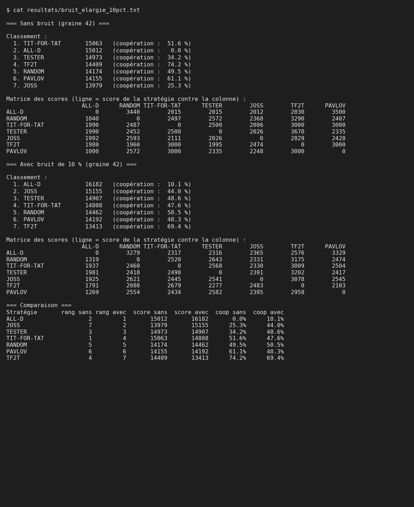
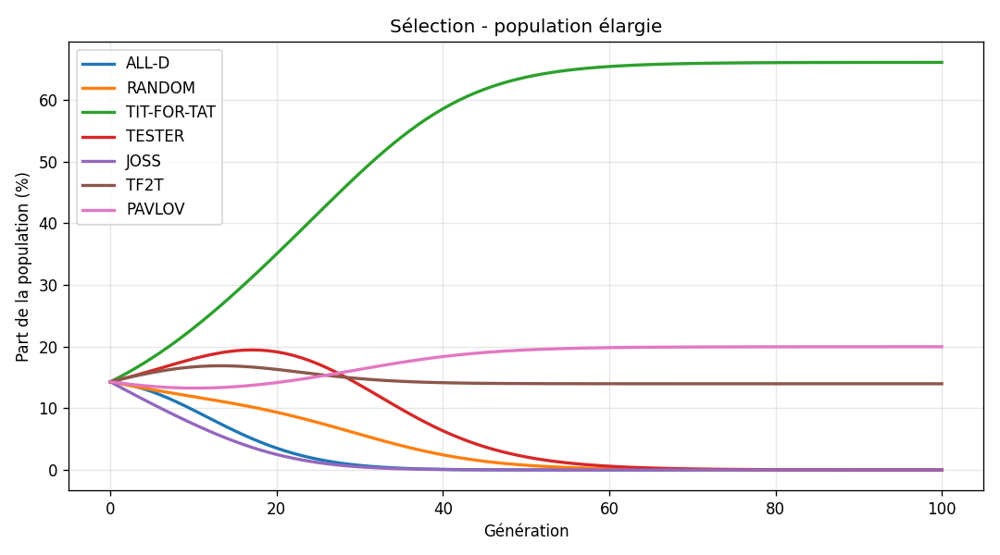
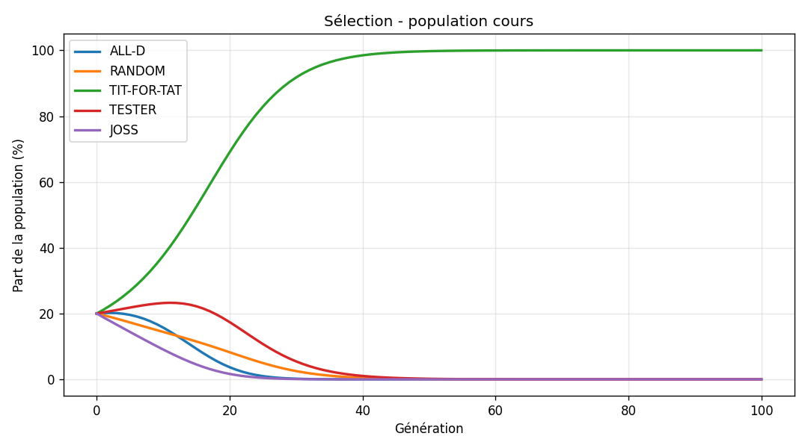

# Journal de bord – Ethan Baudrand

HAI716I Projet 2 (partie 1), tournoi du dilemme du prisonnier itéré. Binôme avec Mohamed Amine EL KAMEL : il a écrit le moteur, les stratégies du cours, l'étape 1 et le bruit ; j'ai écrit TF2T, PAVLOV, l'étape 2 et la sélection.

Le README donne la commande qui relance chaque tournoi. Chaque script écrit sa sortie dans `resultats/`.

---

## 1. Protocole

| Paramètre                  | Valeur                                                  | Raison                                                                                |
| -------------------------- | ------------------------------------------------------- | ------------------------------------------------------------------------------------- |
| Parties × tours            | 5 × 200                                                 | format d'Axelrod imposé par le sujet                                                  |
| Gains                      | CC 3/3, CD 0/5, DC 5/0, DD 2/2                          | matrice du cours ; c'est un dilemme car 5 > 3 > 2 > 0 et 2 × 3 > 5 + 0                |
| Graine                     | 42, un seul générateur pour tout le programme           | les résultats se relancent à l'identique                                              |
| Confrontations             | chaque paire joue une fois, on compte les deux scores   | jouer A contre B puis B contre A compterait deux fois le même duel                    |
| Auto-rencontres            | non par défaut, oui avec `--auto`                       | le sujet dit « chaque autre », mais Axelrod les comptait : on regarde les deux        |
| Modifications de l'étape 3 | bruit et sélection                                      | voir ci-dessous                                                                        |

**Une stratégie est une fonction sans état.** Elle reçoit les deux historiques et le générateur aléatoire, et renvoie C ou D. Tout ce qu'elle sait se déduit de la partie en cours, donc rien ne peut passer d'une partie à l'autre. Les deux coups d'un tour sont calculés à partir des tours précédents seulement, ce qui respecte la simultanéité des choix.

**Pourquoi le bruit.** Il met à l'épreuve la faiblesse trouvée à l'étape 1 : une trahison isolée suffit à lancer un écho de représailles. Le coup inversé est réellement joué, c'est-à-dire qu'il compte dans les gains et que l'adversaire le voit. On a écarté l'erreur de perception de la diapo 72 : chaque joueur y aurait sa propre version de l'historique, et il aurait fallu refaire le moteur.

**Pourquoi la sélection.** Le classement de l'étape 1 est une photo : il dit qui gagne le plus de points, pas si cette victoire peut durer. La sélection répond à cette question ; c'est le tournoi « écologique » d'Axelrod. On utilise la dynamique du réplicateur :

- au départ, toutes les stratégies ont la même part de la population ;
- à chaque génération, le score d'une stratégie est la somme de ses scores de duel, pondérés par la part de chaque adversaire ;
- sa nouvelle part vaut son ancienne part × son score / le score moyen de la population.

On part de la matrice des duels avec auto-rencontres, car dans une population une stratégie croise aussi ses semblables. La simulation dure 100 générations.

**Modifications écartées.** L'horizon inconnu : aucune de nos stratégies ne compte les tours, donc rendre la fin incertaine ne changerait presque rien. Les autres gains : on a gardé la matrice du cours pour que les étapes restent comparables entre elles.

**Vérification.** Avant tout tournoi, `python3 src/verifier.py` contrôle des cas calculés à la main :

- moteur : ALL-D contre ALL-D donne 400 / 400, TFT contre TFT 600 / 600, TFT contre ALL-D 398 / 403, ALL-C contre ALL-D 0 / 1000, et deux lancements avec la même graine donnent les mêmes résultats ;
- nouvelles stratégies : TF2T contre ALL-D donne 396 / 406, PAVLOV contre ALL-D 200 / 700 et PAVLOV contre PAVLOV 600 / 600.

---

## 2. Les stratégies

Pour chaque stratégie : sa règle, son origine, et contre qui elle devrait bien ou mal jouer. Quand le cours laisse un point ouvert, la convention choisie est indiquée.

**ALL-D** trahit à chaque tour.
_Origine :_ cours (diapo 64) ; c'est la stratégie « rationnelle » du raisonnement à rebours.
_Bien :_ contre RANDOM, qu'elle exploite chaque fois qu'il coopère.
_Mal :_ contre les stratégies qui ripostent, car elle tombe en D/D et ne gagne guère plus de 2 points par tour.

**RANDOM** joue C ou D avec une chance sur deux.
_Origine :_ le témoin qu'Axelrod avait ajouté en 1980.
_Mal :_ contre ALL-D, qui l'exploite. Elle ne peut bâtir aucune coopération stable.

**TIT-FOR-TAT (TFT)** coopère au premier tour, puis copie le dernier coup de l'adversaire.
_Origine :_ Anatol Rapoport ; elle a gagné le tournoi de 1980.
_Bien :_ contre les stratégies qui coopèrent (3 points par tour).
_Mal :_ contre ALL-D, car elle perd le premier tour, et contre les stratégies qui trahissent de temps en temps, avec qui elle risque l'écho.

**TESTER** joue TFT si l'adversaire riposte, et répète C, C, D sinon.
_Origine :_ décrite par Axelrod (cours, diapo 64).
_Convention :_ D au tour 1 et C au tour 2. On compte une « riposte » quand l'adversaire joue D au tour 2, car c'est la seule réponse directe à la trahison du tour 1.
_Bien :_ contre les stratégies qui ne punissent pas, qu'elle exploite un tour sur trois.
_Mal :_ contre TFT, avec qui elle entre en écho.

**JOSS** joue comme TFT, mais remplace C par D une fois sur dix.
_Origine :_ Johann Joss, au tournoi de 1980.
_Convention :_ les 10 % s'appliquent aussi au premier tour ; c'est la lecture littérale de la règle.
_Mal :_ contre les stratégies réciproques, car chaque trahison surprise déclenche des représailles qui lui coûtent plus que les 5 points gagnés.

Les deux stratégies suivantes sont nos ajouts de l'étape 2. On les a choisies pour corriger les deux défauts de TFT observés à l'étape 1 : l'écho et les erreurs.

**TIT-FOR-TWO-TATS (TF2T)** coopère, et ne trahit que si l'adversaire a trahi aux deux derniers tours.
_Origine :_ Axelrod a remarqué qu'elle aurait gagné son premier tournoi si quelqu'un l'avait proposée.
_Bien :_ contre les stratégies réciproques, car une trahison isolée ne déclenche pas d'écho.
_Mal :_ contre TESTER, dont le cycle C, C, D ne contient jamais deux D de suite. TF2T ne riposte donc jamais.

**PAVLOV** (« gagne, je garde ; perds, je change ») coopère au premier tour. Ensuite, elle rejoue son coup s'il lui a rapporté 3 ou 5 points, et en change s'il lui a rapporté 0 ou 2. Comme une stratégie n'a pas de mémoire, elle recalcule ce gain à partir des deux derniers coups.
_Origine :_ Kraines et Kraines (1989). Nowak et Sigmund (1993) l'ont rendue célèbre dans un environnement avec erreurs.
_Bien :_ contre sa propre copie après une erreur. Le D/D qui suit rapporte 2 aux deux, qui changent ensemble et reviennent à C.
_Mal :_ contre ALL-D. Après chaque D/D, elle repasse à C et se fait exploiter, ce qui lui donne 1 point par tour en moyenne, contre 2 pour TFT.

_Stratégies écartées :_ ALL-C, qui ne ferait que nourrir ALL-D ; GRIM TRIGGER, car une seule trahison de JOSS ruinerait toute la partie ; TFT généreux, car il figure au cours (diapo 72).

---

## 3. Étape 1 : tournoi de base

Commandes : `python3 src/etape1.py` et `python3 src/etape1.py --auto`. Sorties dans `resultats/etape1.txt` et `resultats/etape1_auto.txt`.

| Rang | Sans auto-rencontres | Avec auto-rencontres |
| ---- | -------------------- | -------------------- |
| 1    | ALL-D 9482           | TFT 12042            |
| 2    | TFT 9056             | TESTER 11594         |
| 3    | TESTER 8976          | ALL-D 11482          |
| 4    | JOSS 8728            | RANDOM 11118         |
| 5    | RANDOM 8477          | JOSS 10753           |

**TIT-FOR-TAT gagne-t-il ? Non : ALL-D gagne et TFT est 2e.** TFT ne gagne qu'avec les auto-rencontres. Trois raisons expliquent l'écart avec 1980 :

1. **TFT n'a personne avec qui coopérer.** Ses points viennent de la coopération mutuelle, qui rapporte 3000 sur 5 parties. Aucun de ses adversaires ne la lui offre : son meilleur duel vaut 2500.
2. **ALL-D vit de RANDOM.** Il lui prend 3440 points, contre 2487 pour TFT face au même adversaire. Contre les trois autres, il ne perd presque rien (environ 2015 chacun). Ces 950 points d'avance suffisent à le mettre 1er.
3. **La population de 1980 était différente.** Elle comptait 14 programmes, dont beaucoup ne trahissaient jamais en premier, et Axelrod comptait les auto-rencontres. Ici, trois de nos cinq stratégies trahissent volontairement. Avec `--auto`, TFT marque 3000 contre sa copie et ALL-D seulement 2000 contre la sienne : TFT repasse devant.

C'est ce que dit la diapo 69 du cours : le score de TFT dépend de la population qu'il rencontre.

**L'écho entre TFT et TESTER.** Ce duel donne exactement 2500 points à chacun.

| Tour   | 1   | 2   | 3   | 4   | 5   | …   |
| ------ | --- | --- | --- | --- | --- | --- |
| TESTER | D   | C   | D   | C   | D   | …   |
| TFT    | C   | D   | C   | D   | C   | …   |

TFT riposte au tour 2. TESTER passe alors en TFT et copie cette riposte, que TFT copie à son tour, et ainsi de suite. Les deux jouent en décalé et marquent alternativement 5 et 0, soit 2,5 points par tour. C'est l'écho de représailles. Il vient de notre lecture littérale de TESTER, qui passe en TFT sans geste de réconciliation. On ne l'a pas corrigé : c'est lui qui nous a orientés vers TF2T.

---

## 4. Étape 2 : population élargie

Commande : `python3 src/etape2.py`. Sortie dans `resultats/etape2.txt`.

Chaque stratégie a maintenant 6 adversaires au lieu de 4. On compare donc la moyenne par adversaire, pas le total.

| Stratégie   | Rang étape 1 → 2 | Moyenne par adversaire 1 → 2 |
| ----------- | ---------------- | ---------------------------- |
| TIT-FOR-TAT | 2 → 1            | 2264 → 2511                  |
| ALL-D       | 1 → 2            | 2371 → 2502                  |
| TESTER      | 3 → 3            | 2244 → 2496                  |
| TF2T        | – → 4            | – → 2402                     |
| RANDOM      | 5 → 5            | 2119 → 2362                  |
| PAVLOV      | – → 6            | – → 2359                     |
| JOSS        | 4 → 7            | 2182 → 2330                  |

**Prédictions et résultats :**

1. _TF2T fera 396 / 406 contre ALL-D, et PAVLOV environ 200 / 700._ **Juste.**
2. _TFT, TF2T et PAVLOV coopéreront entre elles, et le score de TFT montera._ **Juste :** ces trois duels valent 3000.
3. _TESTER exploitera TF2T et montera au classement._ **À moitié juste.** Il lui prend bien 3670 points, son meilleur duel, mais il reste 3e. Il est freiné par l'écho contre TFT (2500) et par son duel contre PAVLOV (2335).
4. _ALL-D perdra la 1re place._ **Juste, mais de peu.** On n'avait pas prévu que PAVLOV lui offrirait une nouvelle victime : ALL-D lui prend 3500 points, plus qu'à RANDOM.

**Bilan.** TFT repasse 1er, avec 51 points d'avance seulement, et sur une seule graine. Un résultat est solide : TFT, TF2T et PAVLOV marquent 3000 entre elles, ce qui donne enfin à TFT les partenaires qui lui manquaient (diapo 62). Aucune des deux nouvelles stratégies ne gagne. TF2T, 4e, se laisse exploiter par TESTER et RANDOM. PAVLOV, 6e, s'effondre contre ALL-D (1000 points, contre 1990 pour TFT). Être plus gentil que TFT ne suffit donc pas.

---

## 5. Étape 3 : le bruit

Commandes : `python3 src/bruit.py --bruit 0.05`, puis `--bruit 0.10`. Les chiffres à 5 stratégies ont été obtenus avant l'ajout de TF2T et PAVLOV (voir les impasses).

**5 %, lancé sans prédiction.** Ce premier lancement a servi à tester le script, avant qu'une prédiction soit écrite. On le traite donc comme une observation exploratoire. Le résultat nous a surpris : la coopération et tous les scores montent. L'explication est que le bruit ne peut détruire que la coopération qui existe, et notre population est bloquée en D/D ou dans des échos C/D. Une erreur peut débloquer un écho : si le joueur qui devait jouer D joue C par erreur, les deux se retrouvent en C/C et y restent jusqu'à l'erreur suivante. Le score de TFT contre JOSS passe ainsi de 2079 à 2317.

**Prédiction pour 10 % (écrite avant le lancement) :**

1. ALL-D coopérera environ 10 % du temps, uniquement à cause du bruit.
2. La coopération de TFT, TESTER et JOSS montera encore.
3. ALL-D restera 1er, mais son avance diminuera.

| Stratégie   | Rang sans → 5 % → 10 % | Score sans → 5 % → 10 % | Coopération sans → 5 % → 10 % |
| ----------- | ---------------------- | ----------------------- | ----------------------------- |
| ALL-D       | 1 → 1 → 1              | 9482 → 9877 → 10277     | 0,0 → 4,7 → 10,2 %            |
| JOSS        | 4 → 3 → 2              | 8728 → 9310 → 9429      | 14,7 → 29,2 → 35,5 %          |
| TESTER      | 3 → 4 → 3              | 8976 → 9018 → 9278      | 26,7 → 39,9 → 43,9 %          |
| TIT-FOR-TAT | 2 → 2 → 4              | 9056 → 9349 → 9217      | 27,3 → 39,1 → 40,0 %          |
| RANDOM      | 5 → 5 → 5              | 8477 → 8959 → 8984      | 49,4 → 50,0 → 50,1 %          |

**Résultats :**

1. **Juste :** ALL-D coopère à 10,2 %.
2. **Juste pour TESTER et JOSS, faux pour TFT**, dont la coopération stagne à 40,0 %.
3. **Faux :** l'avance d'ALL-D sur le 2e grandit (848 points à 10 %, contre 528 à 5 %), et TFT tombe de la 2e à la 4e place.

**Explication de l'écart.** TFT réagit à chaque erreur comme à une trahison. Contre ALL-D, quand ALL-D joue C par erreur, TFT le copie au tour suivant et prend 0 : le score d'ALL-D contre TFT passe de 2015 à 2317. Contre JOSS, les trahisons volontaires se perdent dans le bruit : JOSS n'en paie plus le prix et monte à la 2e place. À 5 %, le déblocage l'emporte ; à 10 %, c'est l'exploitation. TFT est trop rigide pour distinguer une erreur d'une trahison.

**Le bruit avec TF2T et PAVLOV.** Sorties dans `resultats/bruit_elargie_5pct.txt` et `resultats/bruit_elargie_10pct.txt`.

_Prédiction, tirée de l'analyse ci-dessus :_ PAVLOV et TF2T corrigent ce défaut de TFT, donc elles devraient perdre moins de points que lui quand le bruit augmente.

| Stratégie   | Rang sans → 10 % | Score sans → 10 % |
| ----------- | ---------------- | ----------------- |
| ALL-D       | 2 → 1            | 15012 → 16182     |
| JOSS        | 7 → 2            | 13979 → 15155     |
| TESTER      | 3 → 3            | 14973 → 14907     |
| TIT-FOR-TAT | 1 → 4            | 15063 → 14808     |
| RANDOM      | 5 → 5            | 14174 → 14462     |
| PAVLOV      | 6 → 6            | 14155 → 14192     |
| TF2T        | 4 → 7            | 14409 → 13413     |

À 5 %, le classement est le même.

**La prédiction est juste pour PAVLOV et fausse pour TF2T.**

- **PAVLOV résiste au bruit :** son score gagne 37 points, alors que celui de TFT en perd 255. Elle reste pourtant 6e, parce qu'elle part de trop bas contre ALL-D.
- **TF2T s'effondre :** elle perd 996 points et finit dernière. Comme elle ne riposte qu'à deux trahisons de suite, chaque erreur de l'adversaire devient pour lui un gain gratuit. Le cas le plus net est son duel contre PAVLOV : TF2T y tombe de 3000 à 2103, tandis que PAVLOV reste à 2958. On l'a vérifié coup par coup. Quand PAVLOV trahit par erreur, elle gagne 5 et garde donc son coup. TF2T ne riposte qu'au second D, ce qui fait perdre PAVLOV, qui change de coup puis recommence. Une seule erreur lance ainsi un cycle de 4 tours où PAVLOV marque 12 points contre 7 pour TF2T, jusqu'à l'erreur suivante.

C'est le cadre de la diapo 72, où Nowak et Sigmund défendent le TFT généreux. On ne l'a pas testé, puisqu'il figure au cours.

---

## 6. Étape 3 : la sélection

Commandes : `python3 src/selection.py` pour les 7 stratégies, et `python3 src/selection.py --population cours` pour les 5 stratégies du cours. Sorties dans `resultats/selection_elargie.txt` et `resultats/selection_cours.txt`.

**Prédiction (écrite avant le lancement) :**

1. ALL-D grandira au début, grâce à RANDOM.
2. RANDOM, la stratégie la plus faible, disparaîtra vite.
3. Une fois RANDOM disparu, ALL-D n'aura plus personne à exploiter et déclinera.
4. À la fin, les stratégies réciproques domineront : TFT, TESTER et les nouvelles.

**Parts finales.** Avec les 7 stratégies : TFT 66,07 %, PAVLOV 19,97 %, TF2T 13,97 %, et 0 % pour les quatre autres. Avec les 5 du cours, TFT finit seul à 100 %.

**La victoire d'ALL-D à l'étape 1 ne dure pas :** dans les deux populations, sa part tombe sous 1 % dès la génération 30.

**Résultats :**

1. **Faux** pour la population élargie, **à peine vrai** pour celle du cours, où ALL-D culmine à 20,19 % à la génération 2. Il ne marque que 2000 contre lui-même et environ 2015 contre TFT et TESTER. Son seul bon duel, contre RANDOM, ne suffit pas à le placer au-dessus de la moyenne.
2. **Faux.** JOSS et ALL-D disparaissent avant RANDOM : à la génération 30, RANDOM est encore à 5,78 %, contre 0,74 % pour ALL-D et 0,50 % pour JOSS. La plus faible au départ est JOSS, dont les trahisons gratuites déclenchent des représailles chez toutes les stratégies réciproques.
3. **L'issue est juste, mais pas la raison.** ALL-D est sous la moyenne dès le départ : il n'a pas besoin que RANDOM disparaisse pour décliner.
4. **À moitié juste.** TFT, PAVLOV et TF2T survivent, mais TESTER disparaît. Une fois les exploiteurs éliminés, l'écho contre TFT le bloque à 2500, sous les 3000 que les trois autres marquent entre elles.

**À retenir :**

- Les parts 66 / 20 / 14 restent figées, parce que les trois survivantes marquent 3000 entre elles et que plus rien ne les départage. Ce partage s'est joué pendant les premières générations, quand TFT résistait mieux que les deux autres à ALL-D et à TESTER. Il ne traduit pas une supériorité de TFT à la fin.
- La sélection élimine les exploiteurs, et il ne reste que les coopérateurs dont TFT a besoin pour gagner (diapos 62 et 69).
- **Limite :** le modèle n'a pas de mutation, donc une stratégie éteinte ne revient jamais.

---

## 7. Impasses

- **Le bruit à 5 % a été lancé avant d'écrire la prédiction.** On l'a traité comme une observation exploratoire, et on a écrit une vraie prédiction avant de lancer le tournoi à 10 %.
- **`ImportError` :** `bruit.py` importe mes stratégies, et plantait tant que mon fichier était vide. On a placé un dictionnaire vide dans `strategies_nouvelles.py`, pour que chacun puisse avancer sans attendre l'autre.
- **`bruit.py` ne redonne plus les tableaux à 5 stratégies.** Il lit `STRATEGIES_NOUVELLES`, donc il joue à 7 stratégies depuis l'ajout de TF2T et PAVLOV. Les chiffres à 5 stratégies restent justes : on les retrouve en appelant `tournoi()` avec les 5 stratégies du cours. Pour pouvoir les relancer, il faudrait ajouter une option `--population` à `bruit.py`.
- **Tous les tirages passent par un seul générateur.** Ajouter une stratégie décale donc les tirages, et les duels impliquant RANDOM ou JOSS varient légèrement d'un tournoi à l'autre (TFT contre RANDOM vaut 2487 ou 2484). Ces écarts restent faibles devant ceux qu'on analyse.
- **Les totaux ne se comparent pas entre les étapes 1 et 2**, puisque chaque stratégie a 6 adversaires au lieu de 4. On compare la moyenne par adversaire.
- **matplotlib n'était pas installé.** On l'a installé avec `pip3 install --user matplotlib`. `selection.py` tourne quand même sans lui, mais ne produit alors pas de graphique.

---

## 8. Conclusion

- **TFT ne gagne pas par nature.** Il perd l'étape 1 faute de coopérateurs. Il gagne dès qu'il en croise : avec les auto-rencontres, à l'étape 2 et dans la sélection (diapos 62 et 69).
- **La réciprocité stricte a deux défauts :** l'écho de représailles, et l'incapacité à distinguer une erreur d'une trahison.
- **Le bruit a un double effet :** à faible dose, il débloque les échos ; à plus forte dose, il profite aux stratégies opportunistes.
- **Nos deux corrections marchent à moitié.** PAVLOV supporte mieux le bruit que TFT, mais TF2T, trop indulgente, se fait exploiter. Aucune des deux ne prend la tête.
- **La victoire d'ALL-D ne dure pas :** sa part tombe sous 1 % en 30 générations, et TFT finit seul, ou accompagné de PAVLOV et TF2T.
- **Limites :** une seule graine testée, et une sélection sans mutation.
